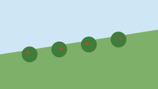

---
md:
  import:
    - from: "@comp-markdown/card@0"
      names: [card]
---

# Three walks

::: grid {min=14rem gap=m}
::: card
### The harbour at dusk

A walk along the old quay, an hour before the boats come in.

:: #image

:: #footer
[Read the walk](#harbour)
::: /card

::: card {background=subtle border=none}
### The old orchard

Apples in October, and a bench at the top of the hill.

:: #image

:: #footer
[Read the walk](#orchard)
::: /card

::: card
### Along the canal

Flat, quiet, and twelve bridges. No picture yet.

:: #footer
[Read the walk](#canal)
::: /card
::: /grid
