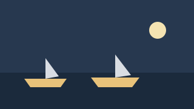

---
md:
  import:
    - from: "@comp-markdown/link-card@0"
      names: [link-card]
---

# link-card

Each example shows its source, then what it draws. A click anywhere on a card follows its link.

**A link card,** its title the text in `[…]`, `href` where it goes and `description` the line under the title:

````compmd {render=both}
---
md:
  import:
    - from: "@comp-markdown/link-card@0"
      names: [link-card]
---

:: link-card[The harbour at dusk] {href="#harbour" description="A walk along the old quay, an hour before the boats come in."}
````

**No description:** the card is its title.

````compmd {render=both}
---
md:
  import:
    - from: "@comp-markdown/link-card@0"
      names: [link-card]
---

:: link-card[Along the canal] {href="#canal"}
````

**Its box changed by the use,** as any box's: a tinted background, a width:

````compmd {render=both}
---
md:
  import:
    - from: "@comp-markdown/link-card@0"
      names: [link-card]
---

:: link-card[The old orchard] {href="#orchard" description="Apples in October, and a bench at the top of the hill." background=subtle width=20rem}
````

**Link cards in a grid,** a "read next" row, as many side by side as fit at 14rem, each as tall as the tallest in its row:

````compmd {render=both}
---
md:
  import:
    - from: "@comp-markdown/link-card@0"
      names: [link-card]
---

## Read next

::: grid {min=14rem gap=m}
:: link-card[The harbour at dusk] {href="#harbour" description="An hour before the boats come in."}
:: link-card[The old orchard] {href="#orchard" description="Apples in October."}
:: link-card[Along the canal] {href="#canal" description="Twelve bridges."}
::: /grid
````

**More than a line, an image or formatted text:** a `card` with `stretch-link`, which any box takes. Its first link, the title, takes the clicks; the other links in it stay links of their own:

````compmd {render=both}
---
md:
  import:
    - from: "@comp-markdown/card@0"
      names: [card]
---

::: card {stretch-link width=20rem}
### [The harbour at dusk](#harbour)

A walk along the old quay, **an hour** before the boats come in. Check [the tide table](#tides) first.

:: #image

::: /card
````
