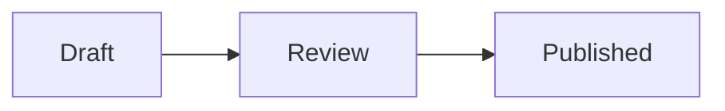
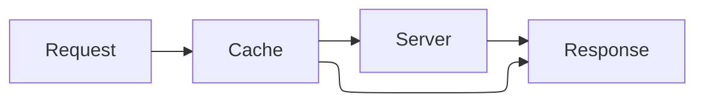
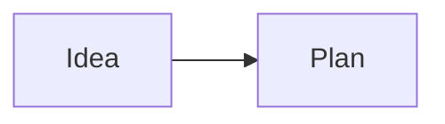

---
md:
  import:
    - from: "@comp-markdown/mermaid@0"
      names: [mermaid]
steps: [Draft, Review, Published]
---

# Mermaid diagrams

A flowchart:



A sequence diagram:

```mermaid {alt="The reader asks the host for a page, and the host answers"}
sequenceDiagram
  Reader->>Host: Open the page
  Host-->>Reader: The page
```

A diagram made from the document's data:

:: mermaid[The steps: draft, review, published] {code=("graph TD; " + md.doc.steps.join(" --> "))}

Laid out with ELK, which Mermaid 12 bundles:



In Mermaid's forest theme:



Sized by the document: fitted in a box 6rem tall, and at the start of its box.

```mermaid {height=6rem alt="Draft, then review, then published, in a short box"}
graph LR
  Draft --> Review --> Published
```

```mermaid {object-position="center start" alt="Idea, then plan, at the start of its box"}
graph LR
  Idea --> Plan
```

One Mermaid can't read:

```mermaid {alt="A diagram with a mistake"}
graph LR
  A -->
```
