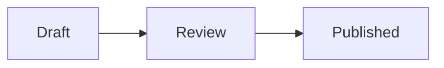
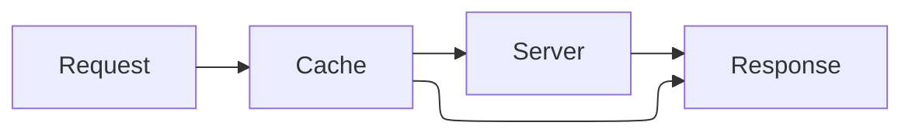
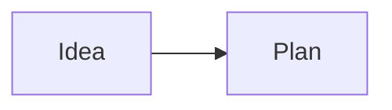

---
md:
  import:
    - from: "@comp-markdown/mermaid@0"
      names: [mermaid]
---

Each example of `mermaid` shows its source, then what it draws.

# A flowchart

A `mermaid` code block draws its code; `alt` is what a screen reader reads, and what shows where it can't draw.

````compmd {render=both}
---
md:
  import:
    - from: "@comp-markdown/mermaid@0"
      names: [mermaid]
---


````

# A sequence diagram

Any of Mermaid's diagrams.

````compmd {render=both}
---
md:
  import:
    - from: "@comp-markdown/mermaid@0"
      names: [mermaid]
---

```mermaid {alt="The reader asks the host for a page, and the host answers"}
sequenceDiagram
  Reader->>Host: Open the page
  Host-->>Reader: The page
```
````

# A diagram from the document's data

As a leaf, its `code` computed.

````compmd {render=both}
---
md:
  import:
    - from: "@comp-markdown/mermaid@0"
      names: [mermaid]
steps: [Draft, Review, Published]
---

:: mermaid[The steps: draft, review, published] {code=("graph TD; " + md.doc.steps.join(" --> "))}
````

# Laid out with ELK

Which Mermaid bundles.

````compmd {render=both}
---
md:
  import:
    - from: "@comp-markdown/mermaid@0"
      names: [mermaid]
---


````

# A theme

`theme` is one of Mermaid's, or `auto`, its light or dark one as the page is.

````compmd {render=both}
---
md:
  import:
    - from: "@comp-markdown/mermaid@0"
      names: [mermaid]
---


````

# A size

Fitted in a box 6rem tall, and at the start of a box.

````compmd {render=both}
---
md:
  import:
    - from: "@comp-markdown/mermaid@0"
      names: [mermaid]
---

```mermaid {height=6rem alt="Draft, then review, then published, in a short box"}
graph LR
  Draft --> Review --> Published
```

```mermaid {object-position="center start" alt="Idea, then plan, at the start of its box"}
graph LR
  Idea --> Plan
```
````

# A diagram Mermaid can't read

Its code shows instead, and the host reports what Mermaid found.

````compmd {render=both}
---
md:
  import:
    - from: "@comp-markdown/mermaid@0"
      names: [mermaid]
---

```mermaid {alt="A diagram with a mistake"}
graph LR
  A -->
```
````
