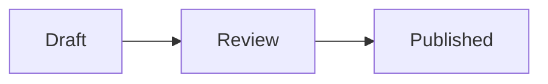

# Code renderers

**Status: proposed.** Part of [components from apps and packs](components-from-apps-and-packs.md), where it is option W2 for Mermaid.

A **code renderer** is a component that renders the code blocks of one language: a pack's `mermaid` draws every ` ```mermaid ` block of a document that imports it. The document writes the block as it would anywhere:

````md

````

A plain renderer shows the code, and GitHub draws the diagram itself.

## Fences and components, today

The spec uses fences for two things, and neither invokes a component:

- **A code block** (` ```mermaid `, ` ```sh `) is content. A processor MAY render it by its language, as GitHub renders Mermaid (§2.3), and `@compmd/render` takes a function per language for it (`code: { mermaid: … }`).
- **A definition fence** (` ```jsx component=chart `, ` ```compmd component=card signature `) defines a component or its signature (§7). Processors remove it from the output.

Components are invoked only with `:::`, `::` and `:` (§3): every component, in every document.

**What this adds** is a third case of the first: a pack can supply the renderer of a code block's language, as a host already can. The block stays a code block in the document and in plain renderers; it is never a way to invoke other components, and only a language a pack names renders this way.

## A leaf, a container or a code block

A component author already chooses between a container (it takes Markdown) and a leaf (it takes params and nothing else). Code renderers add a third choice: a code block, which takes source text in a language of its own.

| The content is | The form | Examples |
|---|---|---|
| Params only, on one line | a leaf | `:: stars[4 of 5] {value=4}`, `:: chart[Sales] {rows=(md.data.sales)}` |
| Markdown, which plain renderers should show as Markdown | a container | `::: card`, `::: tabs`, `::: callout` |
| Source in a language that exists outside CompMD, which plain renderers should show as source | a code block | ` ```mermaid `, ` ```dot ` (Graphviz), ` ```abc ` (music), ` ```vega-lite ` (a chart as JSON), ` ```geojson ` (a map; GitHub draws it) |
| Source computed from data or inputs | a leaf with a param | `:: diagram[Our process] {source=(md.data.steps.map(s, s.name).join(" --> "))}`, since a code block is never interpolated (§8.1) |

The test for a code block: would a reader of the plain Markdown want to see that source, and does a tool outside CompMD already know the language? If not, it's a leaf or a container.

**The closest thing in the spec today is math.** CommonMark has no math, and neither does the GFM spec; GitHub renders ` ```math ` blocks and `$…$` as a feature of its own. CompMD made GitHub's math part of its base syntax (§2.3), so every CompMD parser reads a ` ```math ` block as a `math` node, not a code block. That is a language name giving a code block a meaning, as a code renderer does, with two differences: math is fixed by the spec for every processor, and it changes the tree at parsing; a code renderer comes from a pack the document imports, and the block stays a code block until it is rendered.

## One pack, both forms

A pack may offer a written diagram as a code renderer and a computed one as a leaf, on one drawing function. Each component file exports one component (§6.1), so the pack has a file for each, built from shared source:

````md
<!-- @kit/mermaid's index.comp.md -->
---
md:
  import:
    - from: ./dist/mermaid.js
      names: [mermaid]
    - from: ./dist/diagram.js
      names: [diagram]
  export:
    pack: "@kit/mermaid"
    version: "1.0.0"
    names: [mermaid, diagram]
---

The code renderer, for ` ```mermaid ` blocks:

```compmd component=mermaid signature
code: mermaid
params:
  theme: default | dark | neutral = default
  alt: string?
```

The leaf, for a diagram computed from data:

```compmd component=diagram signature
params:
  source: string
  theme: default | dark | neutral = default
```
````

```ts
// src/draw.ts: both components draw with it
export function draw(target: Element, source: string, theme: string, label: string) { /* Mermaid, then the SVG with aria-label */ }

// src/mermaid.ts: the code renderer; the source is the block's text
export default function mount(target, { params, code }) {
  draw(target, code.text, params.theme, params.alt ?? "");
  return { update: (next, nextCode) => draw(target, nextCode.text, next.theme, next.alt ?? "") };
}

// src/diagram.ts: the leaf; the source is a param, and its fallback the text alternative
export default function mount(target, { params, fallback }) {
  draw(target, params.source, params.theme, fallback.text);
  return { update: (next) => draw(target, next.source, next.theme, fallback.text) };
}
```

A document uses either:

````md
---
md:
  import:
    - from: "@kit/mermaid@1"
      names: [mermaid, diagram]
  data:
    - from: ./steps.yaml
      as: steps
---


:: diagram[Our process, from steps.yaml] {source=("graph LR; " + md.data.steps.map(s, s.name).join(" --> "))}
````

## The questions, with proposed answers

1. **Is it a component?** It has a signature, params, a box and the host contract, so it is one; but it is chosen by the block's language, never by name. Proposed: a *code renderer*, a component whose signature has `code: <language>`. Its name is what a document imports and what diagnostics name.
2. **How a document gets it.** Proposed: by importing it, as any component: `names: [mermaid]`, or `"*"`. A ` ```mermaid ` block in a document that doesn't import one stays a code block, with no diagnostic, since most code blocks are just code. An ambient pack may provide one, at the lowest priority (§6.3).
3. **Two renderers for one language.** Two imports that both render `mermaid` are F023 when a ` ```mermaid ` block is used, as two wildcard imports of one name are, and listing one explicitly resolves it. A code renderer named like another component is F013, as any duplicate name.
4. **Params on the info string.** CommonMark leaves everything after the language to the writer, and tools use it in different ways (Pandoc's `{.class}`, a `title="…"`). Proposed: a param list in braces after the language, with the param grammar of §3.1: ```` ```mermaid {theme=dark width=50%} ````. Without a code renderer, the info string's rest is kept, as now. Only definition languages (§7) take `component=`; ```` ```mermaid component=x ```` is an ordinary code block whose info string has `component=x` in it.
5. **The code's text in the contract.** Proposed: a new `code` in the mount context (§7.4), `{ language, text }`, with no slots: `mount(target, { params, code, fallback, … })`. `update` gets the new params and the new `code`, since an edit of the block changes its text.
6. **The box.** A rendered code block is a block with an outer box, as any component, so the common params apply (`width`, `padding`, `border`, breakpoints).
7. **Fallback and accessible text.** The fallback is the code block itself (§4.5): what a plain renderer shows. A diagram needs a text alternative for screen readers, which a code block doesn't have: an `alt` param, and W101 when it's missing, as for a leaf without fallback text.
8. **No interpolation.** `{{md.doc.x}}` in a ` ```mermaid ` block stays as written (§8.1); computed source is the leaf's job.
9. **The host's own renderers.** `@compmd/render`'s `code` option stays: a host that renders `mermaid` itself is an ambient code renderer, and a document's import wins over it (§6.3).
10. **No inline form.** CommonMark has no language for a code span, so code renderers are blocks only.

## What it means for the spec

| Section | Change | Conflict with today's text |
|---|---|---|
| §2.3 | code blocks of a language rendered by a pack's code renderer, next to "a processor MAY render a code block by its language" | none: it extends it |
| §3 | the param list on a code block's info string | §3 lists every CompMD form; this is a sixth, inside a fence's info string, which parsing reads only for code renderers |
| §4.5 | a code renderer's fallback is its code block | none |
| §6.3 | resolution by language; F023 for two renderers of one language | none |
| §7, §7.3 | `code: <language>` in a signature; `component=` only on definition languages | §7 says a fence whose info string has `component=` defines a component; it needs "in a definition language" |
| §7.4 | `code` in the mount context, and in `update` | `update(params, slots)` gains an argument |
| §8.1 | no interpolation in code blocks, as now | none |
| §12.3 | a code block in the expanded tree carries its renderer and params, as a component node does | the schema's `code` node gains fields |
| §10.2 | W101 for a rendered code block without `alt` | W101 names leaves only |

## Content in another language (an idea, for later)

A code renderer's signature says its block's content is Mermaid. The same declaration can tell an editor how to treat it: highlighting, completion, diagnostics. A signature could name the language of a code block it renders (`code: mermaid`) or of a slot's content, and a pack could ship what an editor needs for it: a TextMate or tree-sitter grammar for highlighting, and optionally a language server for completion. An editor that knows CompMD would then highlight a Mermaid block in any document that imports the pack, without knowing Mermaid itself. This is its own design, after code renderers.
