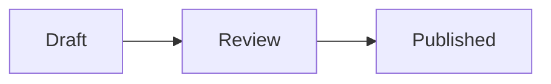

# Components from apps and packs

**Status: accepted (2026-10-30).** S3 (libraries from the registry) is still open.

How the sandbox builds the three levels, where the page renders, a frame per use and how a built module's file is checked, is its own design: [the sandbox](sandbox.md).

A document names components; their code comes from somewhere. This design answers two questions that turn out to be one:

1. **An application has components of its own**, written in React or Svelte and built with the app (a rating widget, a map, a chart bound to the app's data). How does it let its documents use them?
2. **A pack ships code** for others to use: a chart kit, a Mermaid diagram component with a large library inside. How does that code reach a reader, and how fast?

Both are about who supplies a component's code, and so how much it is trusted, how it is loaded, and how authors write, share and reuse it. The design splits them into four questions, each with its options: where code runs and with what trust (Q1), how a host makes components available (Q2), how a pack ships its code (Q3), and, for Mermaid, how a document writes a diagram (Q4).

## Proposed decisions

1. **One pack format for every component's code**, whoever supplies it: an app's own `stars`, a shared chart kit, Mermaid. A pack is a folder or an npm package with a `package.json` and a document of signatures and imports, as today (spec §6.4). An app's own components are a pack too, a folder in the app's repository, so no host writes signatures in code and every host reads the same pack the same way.
2. **Trust is the host's configuration, per pack** (Q1). Three levels: *strict sandbox* (the default, spec §15 today), *permissive sandbox* (network to listed origins, `host` for the host's data: §15 and §7.4 allow both today), and *trusted* (in the page, with the app's own trust; new, and only for a pack built with the app). A document never raises a pack's trust.
3. **A host adds a component with one line of configuration, not code** (Q2): `compmd.config.json` lists the packs a host gives its documents, with their versions and trust. A host fills it the way it is built: a bundler plugin for a web app (packs are npm dependencies, served from the app's own origin), a folder of packs for a desktop app, the registry at run time for a host where readers pick packs, as the playground.
4. **The sandbox is a package**, `@compmd/sandbox`, and it carries the security, not the host: the frames, their content security policies, one sandbox per trust and per document, the network a permissive pack is given and nothing more, the import map, loading and compiling component code. A host gives it the configuration and the trees; it never writes a policy itself. Today all of it is the playground's own code, so every other app would build its own.
5. **A document may import any npm pack, into the strict sandbox** (Q2, which packs a document may import): a host lists packs only to give them more (a permissive sandbox, trusted) or to make them ambient, and may deny packs by name, as its own policy (content, cost, licences), not for security, which the strict sandbox gives. The host fetches packs for the reader, through its own cache.
6. **A pack ships source or built modules; large code loads by URL** (Q3): from the host's origin, checked against the pack's integrity, cached across documents and visits. Whether a pack may also name libraries the host resolves from the registry, instead of bundling them, is open (Q3, S3).
7. **A host's pack name is the host's.** A document may import a pack the host configures by name to say what it depends on; a processor resolves that name to the host's pack, never to a registry package of the same name, as it does for `@compmd/*`.
8. **Mermaid is written as a plain fenced block** (Q4): a pack can render the code blocks of a language, so a document writes ` ```mermaid ` alone, as on GitHub. This is not a way to invoke components: components are still invoked only with `:::`, `::` and `:` (spec §3). Its own design: [code renderers](code-renderers.md).

## Today

What each part does, before this design. *Spec* is what `compmd-spec-v1.md` says; *processor* is `compmd` and `@compmd/processor`; *render* is `@compmd/render`; *playground* is the editor on the website.

- **What runs where.** The playground renders the page in a sandboxed iframe with an opaque origin and a content security policy that allows no requests (`default-src 'none'`). Document code reaches the frame as text: the processor's output carries each host-language component's code (`HostComponent.code`). The frame compiles it in the browser (sucrase for JSX and TSX, Svelte's compiler for Svelte), loads it as a `blob:` module, and mounts it through its binding (spec §7.6). Its imports resolve only through the frame's import map: React, React DOM, Svelte and d3.
- **What the packages give an app, and what they leave to it.** `@compmd/render` gives the frame protocol (`connectFrame` in the host page, `serveFrame` in the frame), which carries trees in and `set` calls out. Everything else in the list above is the playground's own code (`editor/src/frame/`: compiling, loading, the policy, the import map): an app that runs document code has to build its own sandbox. `@compmd/processor` doesn't fetch packs either: the host gives it each pack's files in the request.
- **Trust.** The spec has it (§15: a host may give packs its configuration trusts network and `host`; §7.4: `host`). Nothing implements it: no configuration marks a pack trusted, and the playground runs all code with no network.
- **An app's own components.** Pass the renderer `components: { stars: react(Stars) }`. A document that writes `:: stars` gets F002 unless the processor knows the name, and the way it does is an ambient pack (spec §6.3) whose document holds a signature fence alone, as below. §17 records this decision ("a signature fence in a processor's pack marks a component the processor implements"), but §7.1 and §15 don't say it, and §15 says all component code runs sandboxed.

**A host component today**, checked with `@compmd/processor` 0.1.1. The host provides an ambient pack whose document exports a signature alone:

````md
---
md:
  export:
    pack: "@acme/app"
    version: "1.0.0"
    names: "*"
---

```compmd component=stars signature
params:
  value: number
```
````

The document `:: stars[4 of 5] {value=4}` then gives a `componentLeaf` named `stars`, with its params validated (`value="x"` is F009, `color=red` F008) and W113 for a name only this host has. `componentsOf` lists `stars` as kind `processor`, from the host's pack. The renderer mounts it from `components`.

Two problems remain with it:

- **Each host writes its own pack, in code.** The host builds the pack's JSON in its request; nothing standard says where an app's signatures live, so two apps that use the same component write the same signatures twice.
- **No pack can run with more than the sandbox.** Spec §15 allows network and `host` for trusted packs, but nothing implements it, and nothing lets a pack the host trusts run in the page.

## The examples

Each option below is weighed on these.

1. **`stars`**, an app's own React component: a 5-star rating that shows a value and, bound to an input, sets it.
2. **`rating-summary`**, an app's own Svelte component that reads the app's data through `host` (spec §7.4).
3. **`@acme/charts`**, a pack of bar, line and pie charts in React and Svelte, published on npm and used by many documents in many apps.
4. **`@kit/mermaid`**, a pack with one component, `mermaid`, that draws a Mermaid diagram. Mermaid 11 is 3.57 MB as one ES module, 976 KB gzipped.
5. **`@acme/maps`**, a map component that loads tiles from `tiles.example.com`: a pack that needs the network.

## Q1. Where code runs, and with what trust

| | T1. Strict sandbox (`strict`) | T2. Permissive sandbox (`permissive`) | T3. Trusted (`trusted`) |
|---|---|---|---|
| What the code can reach | its contract: params, slots, its target, `set` (spec §15) | T1, plus the network to origins the host lists, and `host` | everything the app's page can: its session, its data, the network |
| Example | `@acme/charts`, `@kit/mermaid` | `@acme/maps` (its tile origin), `rating-summary` (`host`) | `stars`, `rating-summary` built with the app |
| Who decides | the default | the host's configuration, per pack | the host's configuration, for a pack built with the app |
| Spec | §15 | §15 (network for trusted packs), §7.4 (`host`) | not allowed: §15 says all component code runs sandboxed |
| Processor | gives code as text | no trust configuration | works (the signature alone, above) |
| Render | frame protocol | `MountContext.host` exists in the contract | `components` |
| Playground | yes | no | no |

- **T1** is the only safe level for code from a document or a registry: the code can't send what it sees anywhere, whatever it is.
- **T2** keeps the sandbox, so a trusted pack still sees only its contract, plus what the host chose to add. A map pack given its tile origin can send params to that origin; the host chose that when it listed the origin. `host` acts outside the document only on the reader's action (spec §15, "Components the host trusts").
- **T3** is for code that is already the app's: built from the app's repository, reviewed with it, shipped in its bundle. Running it sandboxed would protect the app from itself. It costs nothing to load and mounts synchronously, without the frame's message hop. Its inputs still come from documents, so it treats params and slot content as untrusted: no `innerHTML` from a param, URLs checked, actions outside the page only on the reader's action.
- **T3 for a registry pack** would give a third party the app's session. The design allows T3 only for a pack whose path is in the app's own repository (`./components`), not for a registry name: a registry pack that needs more gets T2.
- **The names.** The spec says "packs its configuration trusts" for what is T2 here (§7.4, §15). With T3 named *trusted*, the spec's wording becomes "permissive packs", so the word means one thing.
- **Who enforces them:** `@compmd/sandbox` (decision 4). The host names each pack's level in its configuration; the package makes the frames and their policies: T1 packs of one document share a frame with no network; each T2 pack gets a frame of its own, whose policy allows only its listed origins; T3 components are mounted in the page by the renderer, as `components` does today.

## Q2. How a host makes components available

### H1. Code: `hostPack(name, signatures)` (the first draft)

```ts
const app = hostPack("@acme/app", { stars: "params:\n  value: number" });
const { expanded } = process({ path: "notes.comp.md", files, now, ...app });
```

- Every host writes code for every component it adds, and signatures as strings in that code. Rejected: one line of configuration should be enough (H2 to H4).

### H2. Configuration, filled from the registry at run time

```json
{
  "packs": {
    "@acme/charts": { "version": "^2.1.0" },
    "@kit/mermaid": { "version": "1.0.0", "integrity": "sha512-…" },
    "@acme/maps": { "version": "3", "trust": "permissive", "network": ["https://tiles.example.com"] },
    "./components": { "trust": "trusted" }
  },
  "ambient": ["@acme/app"]
}
```

`compmd.config.json` (or the `compmd` key of the app's `package.json`) lists the packs that get more than the strict sandbox, with their versions and trust, and the packs every document gets without importing them (`ambient`). Which other packs a document may import is the next section's question.

- **Security:** only the host gives a pack more than the strict sandbox; a document can't. Pinned versions and integrity as for imports (spec §6.1).
- **Speed and size:** packs are fetched on first use from the registry or a cache, then cached.
- **Experience:** one line per pack. Suits a host where readers or authors pick packs (the playground), with an allowlist of what they may pick.

### H3. Configuration, filled at build time (recommended for web apps)

The same configuration, with the packs as the app's npm dependencies:

```sh
npm install @acme/charts @kit/mermaid
```

A bundler plugin (`@compmd/vite`, with others to follow) reads the configuration and:

- gives the processor each pack's documents, so no host builds a request by hand;
- serves each pack's files from the app's own origin, with their integrity, for the sandbox to load (T1, T2);
- bundles a T3 pack's components with the app, so `stars` is compiled once by the app's own build, with its TypeScript checked;
- checks the app's own pack against its components (W104, spec §7.1).

The app's own pack is a folder:

````md
<!-- components/index.comp.md -->
---
md:
  import:
    - from: ./Stars.tsx
      names: [{ name: Stars, as: stars }]
  export:
    pack: "@acme/app"
    names: [stars]
---

```compmd component=stars signature
params:
  value: number
```
````

- **Security:** as H2; packs come with the app's dependencies, so the app's lock file pins them and its review sees their updates.
- **Speed and size:** nothing fetched from a registry at run time; packs load from the app's origin and cache with the app.
- **Experience:** `npm install` and one line of configuration for a shared pack; a signature next to the component for the app's own.

### H4. A folder of packs

A host reads packs from a folder (`~/.config/acme/packs/`, or `packs/` next to a site's documents), each a pack as the registry gives it; the configuration says their trust. Suits desktop apps and static sites; the same configuration as H2 and H3.

### Compared

| | H1. Code | H2. Configuration, registry | H3. Configuration, build | H4. A folder |
|---|---|---|---|---|
| To add a component | code in the app | a line | `npm install` and a line | a folder and a line |
| The app's own components | signatures in code | — | a pack folder, built with the app | a pack folder |
| Fetched at run time | no | yes, on first use | no | no |
| Spec, processor, render, playground today | none | none | none | none |

### Which packs a document may import

- **P1. Only listed packs:** the configuration is an allowlist, and any other import is F026.
- **P2. Any npm pack, in the strict sandbox (recommended):** a document imports any pack; the configuration lists only the packs that get more, and may deny packs by name (`"deny": ["@bad/pack"]`).

P2 gives authors the most: a document written for one host works in any other with the same packs, and nobody has to ask a host to add a pack. The strict sandbox is what makes it safe. Challenged, case by case:

| A bad or broken pack | With P2 | What it needs |
|---|---|---|
| Sends the reader's data somewhere | can't: no network, no session (§15 rules 2, 3) | the strict sandbox, enforced by `@compmd/sandbox`, not by each host |
| Reads another document's data | can't, if each document has its own sandbox. §15 today lets documents shown together share one when the host trusts their code the same: with P2 a host can't vouch for packs it never saw | one strict sandbox per document for packs the host didn't list |
| Writes a document's inputs to leak them through a data URL | can't: a `from` can't use an input a component can change (F031) | nothing new |
| Draws something misleading in its box ("Your session expired: password") | can: its box is its own, and a reader may believe it. What's typed in can't leave, though | the sandbox's frames drawn as the document's content, never over the host's own interface |
| Uses the reader's CPU or memory, or downloads 50 MB | can, until stopped | the stop rule (§15 rule 5), and a size limit per pack in the host's configuration |
| Tells the registry who reads what | a fetch from the registry at view time gives it the reader's address | packs fetched through the host's cache, never from the reader's browser to the registry (§15, privacy) |
| Changes under the document (a new release of a range) | can, as any import | `integrity` on exact versions (§6.1), as today |
| Is a typo of a good pack (`@acme/chart` for `@acme/charts`) | renders the wrong thing, inside the sandbox | the deny list, and the import's version shown in `componentsOf` |
| Breaks other documents | doesn't: only documents that import it, in their own sandbox | as above |

So "only their pages fail" holds, with three conditions: the sandbox is per document for unlisted packs, the host fetches packs, and packs have a size limit.

**The deny list is not for security.** The strict sandbox keeps readers safe from any pack, known or not; a deny list can only name packs someone already knows about. It is the host's own policy, for reasons that aren't the reader's safety:

- **Content:** a school's host denies a pack of games, a company's host a pack that draws content it doesn't want shown.
- **Cost and size:** a pack the host doesn't want to fetch, cache and serve.
- **Licences:** a pack whose licence the host can't redistribute.
- **Misuse:** a pack used to draw fake prompts or ads in documents on the host.
- **A flaw found in a widely used pack or browser:** denying it, or one version of it, stops it at once while a fix is published. The sandbox still holds, so this is defence in depth, not the defence.

A denied import is F026, with the host's reason in its message, and its uses render fallbacks.

- **Hosts that render for others** (a published site) still give no unlisted pack anything but the strict sandbox, so P2 changes nothing for `host` (§15, "Reading for others").
- **A host may still choose P1**, for example a company's internal app that allows only reviewed packs: `"imports": "listed"`.
- **Spec:** §6.4 says a processor fetches packs from a registry it is configured with; P2 adds the per-document sandbox for unlisted packs (§15), and fetching through the host.

## Q3. How a pack ships its code

### S1. Source, compiled in the sandbox (today)

A pack's document imports component files (`./bar-chart.jsx`) or holds fences; the sandbox compiles them.

- **Security:** sandboxed. Source is reviewable: the code that runs is the code in the package. Versions and `integrity` pin it (spec §6.1); npm provenance says where a version was built.
- **Speed and size:** each component's text travels through the processor's output on open; the frame loads a compiler the first time a document needs one (sucrase 43 KB gzipped for JSX and TSX, Svelte's compiler 221 KB), and compiles each component per open. Imports are limited to the import map. Fine for charts in plain SVG; impossible for Mermaid, whose library isn't in the map and is too large to pass as text.
- **Experience:** a component file and a signature, tried live in the playground; `npm publish`; `import: [{from: "@acme/charts@1", names: "*"}]`.
- **Spec:** says nothing about compiling in the browser or the import map, which every host that runs S1 needs to agree on. To settle once Q3 is decided.

### S2. Built modules, loaded by URL (recommended for large components)

A pack ships a component as one built ES module in the plain binding (`mermaid.js`, `export default function mount(target, context)`), its libraries bundled in. The processor gives the renderer where the module is (the pack, its version, the file and the pack's integrity) instead of its text; the sandbox loads it from the host's origin, which serves the pack's files (H3, H4) or fetches them (H2).

- **Security:** sandboxed, as S1. Built code is harder to review than source, so it rests more on provenance and integrity: the module is checked against the pack's integrity, and the sandbox's policy allows scripts from the host's own pack files only. A compromised Mermaid still can't send what it draws anywhere.
- **Speed and size:** no compiler. Mermaid's 976 KB load only for a document that uses it, once, and stay cached by URL across documents and visits, since a published version never changes. For comparison, the processor itself is 808 KB gzipped.
- **Experience:** the author builds the module (below); the playground can use it, not edit it.

**Writing `@kit/mermaid` with S2, step by step:**

1. `npm create @compmd/pack mermaid`: a template with `package.json` (depending on `mermaid`), `src/mermaid.ts` (the mount function), `index.comp.md` (the signature and the import of `./dist/mermaid.js`), a build script and a test page.
2. Write the mount function: read the slot, call Mermaid, put the SVG in `target`.
3. `npm run build` bundles `src/mermaid.ts` with Mermaid into `dist/mermaid.js`; `npm run dev` opens the test page with the playground's sandbox.
4. `npm publish`. A host adds it with `npm install @kit/mermaid` and a line of configuration (H3); a document imports `@kit/mermaid@1`.

A pack doesn't have to be published: a folder next to the documents works as a relative import (`from: ./mermaid/index.comp.md`), for one site.

### S3. Libraries from the registry, resolved by the host (open)

The pack names its libraries instead of bundling them: `@kit/mermaid` ships its own 2 KB mount function, and its `package.json` depends on `mermaid@11`. The host resolves `mermaid` from the registry (at build time with H3, through a registry mirror with H2) and the sandbox's import map points to it.

- **Security:** the same trust as S2: the pack's author chose Mermaid either way, and the code still runs sandboxed. What changes is what's checked: the host's lock file pins `mermaid`'s version and integrity, instead of the pack's integrity covering it.
- **Speed and size:** two packs that both use Mermaid share one copy, cached once. Each pack is small.
- **Experience:** the pack author writes no build step: the template becomes a `package.json`, a mount function and a signature. A standard way for every pack.
- **Costs:** the host must resolve npm dependencies for the sandbox (a bundler or a registry mirror), and two packs needing different major versions of a library get one each. A host without a build step can't run S3 packs offline.
- **Spec:** §15 rule 2 says a component's code comes from its pack; S3 widens it to "from its pack and the packages it depends on, pinned by the host".

S3 is the simpler path for authors and S2 the simpler one for hosts. Both can be allowed, with S2 first.

### Compared

| | S1. Source | S2. Built module by URL | S3. Libraries from the registry |
|---|---|---|---|
| Download for the reader | text + a compiler (43–221 KB), per open | the module, once, cached | the pack and its libraries, once, cached, shared between packs |
| Libraries | the import map's | anything, bundled | anything, resolved by the host |
| Author's build step | none | a bundler (template) | none |
| Spec | §6.1, §6.4, §7 | `.js` component files (§6.1), the plain binding (§7.6); loading by URL not | not allowed (§15 rule 2) |
| Processor | the code as text | the code as text | — |
| Render | — | — | — |
| Playground | yes (its example pack) | no | no |

## Q4. How a document writes a diagram

### W1. A container around a fenced block (the first draft)

````md
::: mermaid

::: /mermaid
````

Works with today's spec: the component reads its slot. But the language is written twice, and a plain renderer shows two literal component lines around the fence.

### W2. The fenced block alone, rendered by a pack (recommended)

````md

````

A pack's *code renderer* renders every ` ```mermaid ` block of a document that imports it; a plain renderer shows the code, and GitHub draws it. It isn't a way to invoke components, which stay `:::`, `::` and `:`. Its own design, with when to choose a leaf, a container or a code block, a pack that offers both, the questions it raises and what it changes in the spec: [code renderers](code-renderers.md).

### W3. A container with raw text (rejected)

````md
::: mermaid
graph LR; Draft --> Review --> Published
::: /mermaid
````

The body is Markdown, so the diagram is parsed as a paragraph (`|label|` becomes a table cell, line breaks are lost), and GitHub doesn't draw it.

## What would change, if this is approved

None of this exists today.

**The spec:**
- §6.3: a pack the host configures resolves to the host's pack, never to a registry (decision 7).
- §7.1: a signature fence alone, in a pack whose code the host provides, declares a component the host implements (as §17 already records).
- §15: the three trust levels (strict, permissive, trusted), set per pack by the host's configuration; trusted only for packs built with the app; host code's inputs are untrusted; one strict sandbox per document for packs the host didn't list; packs fetched by the host, with a size limit. §7.4's "packs its configuration trusts" becomes "permissive packs".
- §6.4 and §15: a pack's built module is loaded from the pack's files and checked against its integrity (S2).
- Code renderers (W2): the sections listed in [code renderers](code-renderers.md#what-it-means-for-the-spec).
- After Q3 is decided: what a host that compiles source (S1) provides (the import map, the compilers).

**The processor:** `HostComponent` gives a built module's place (pack, version, path, integrity) instead of its text (S2); code blocks rendered by a component (W2); the configuration's packs and trust in the request.

**The packages:**
- `@compmd/sandbox`: the frames and their policies for each trust level, one per document for unlisted packs, the import map, loading and compiling code, from the playground's `editor/src/frame/`; with tests that a component can't reach the network, the page or another document.
- `@compmd/vite`: the bundler plugin (H3).
- `@compmd/create-pack`: the pack template (S2).
- `@compmd/render`: the frame protocol takes a module's URL to load (S2).

**The playground:** loads packs from its configuration (H2), built modules by URL (S2), and the Mermaid pack (W2).

**The website's landing page:** its "Use it in your app" section shows H3: `npm install`, the configuration, and the app's own `stars` as a pack folder; a live example with `stars`.

**The conformance set:** a host's signature in a configured pack (W113, validation, a `componentLeaf`), a configured pack imported by name, and a fenced block rendered by a component (W2).

## What this means for the Mermaid pack

`@kit/mermaid` is a built module (S2), written as a fenced block (W2), in the strict sandbox (T1). A document imports it like any npm pack (P2); a host that wants it bundled adds it with `npm install` (H3). It could be written now with today's spec as W1 and S1, its module as a component file whose 3.57 MB pass through the processor as text; this design makes it fast and plain to write.

## Not in this change

- Packs from registries other than npm.
- Lock files for documents (spec §6.1 leaves them to processors); a host's lock file covers its packs.
- Languages for content: an idea in [code renderers](code-renderers.md#content-in-another-language-an-idea-for-later).
