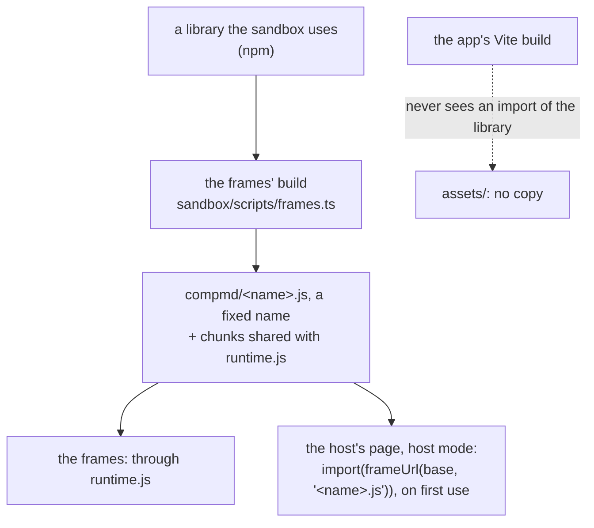

# Libraries in the sandbox

**Status: accepted (2026-11-04).** Where a library that `@compmd/sandbox` loads into its windows is built, and how a host-mode page uses it, so that an app ships it once. It came from Shiki and Temml, which every app built with `@compmd/vite` once shipped twice; follow it for the next one (a diagram renderer, a chart library the sandbox itself draws with, another highlighter).

## Decisions

1. **A library the sandbox loads is built once, by the frames' build** (`sandbox/scripts/frames.ts`), into `dist/frames/`, which `buildFrames` and `@compmd/vite` copy into each app's `compmd/`. The app's own bundler never bundles it.
2. **The host's page loads the frames' copy, never its own.** Code that runs in the host's page (`hostPage` in `sandbox/src/sandbox.ts`, `sandbox/src/host/runtime.ts`) doesn't import the library, statically or dynamically: a bundler that sees `import("temml")` in a package the app imports bundles a copy into the app's `assets/`. It imports an entry of the frames' build by its URL, where the host serves the frames (`frameUrl(base, …)`), the first time a page needs it (`sandbox/src/from-frames.ts`).
3. **The other way round can't work:** the frames are sandboxed, with an opaque origin and a policy that loads scripts from `compmd/` only, so they never load the app's files. The app's page may load `compmd/`, its own deploy, served with `Access-Control-Allow-Origin: *`.
4. **Loaded when first needed,** in every window: a page without math loads no Temml. Until it loads, what it draws shows as text (code, TeX).
5. **Runtimes component code imports** (React, React DOM, Svelte) are another case, already shared: `libs/` and the frames' import map (`buildLibraries`, `RUNTIMES`), one copy for every frame (spec §7.6).
6. **A host that renders a page itself** with `createPage` (not `createSandbox`) and gives it the library's renderer (`shikiHighlight()`, `temmlMath()`) bundles its own copy. That is its choice, and these exports stay.

## Adding one

1. **Use it in the frames:** import it lazily (`await import("…")`) where the frame runtime needs it, behind a small renderer, as `sandbox/src/math.ts` and `sandbox/src/highlight/highlight.ts` are.
2. **If a host-mode page needs it too,** add an entry with a fixed name to the frames' build, `input` in `sandbox/scripts/frames.ts` (`highlight` and `math` are there), exporting the renderer; add its name to `frameUrl`'s; and give `hostPage` a renderer from `from-frames.ts` that imports it by its URL (`import(/* @vite-ignore */ url)`), as `framesHighlight` and `framesMath` do.
3. **Check one copy:** add the library's chunk names to the two checks that an app's bundle has none (`vite/test/example.test.ts`, *has Shiki and Temml once*; `website/scripts/check.ts`, `oneCopy`, for the site and the playground), and its entry to what they expect in `compmd/`.
4. **Measure it** on the frames' build, gzipped, and write the numbers where the sandbox README describes the library, as *Code blocks* has Shiki's.
5. **Say so:** the sandbox README's table of what each page mode does, and *What the frames load* in guides chapter 11, list the entry.

A host's page with a content security policy allows scripts from where the frames are served (the sandbox README says so); a new entry needs nothing more.
