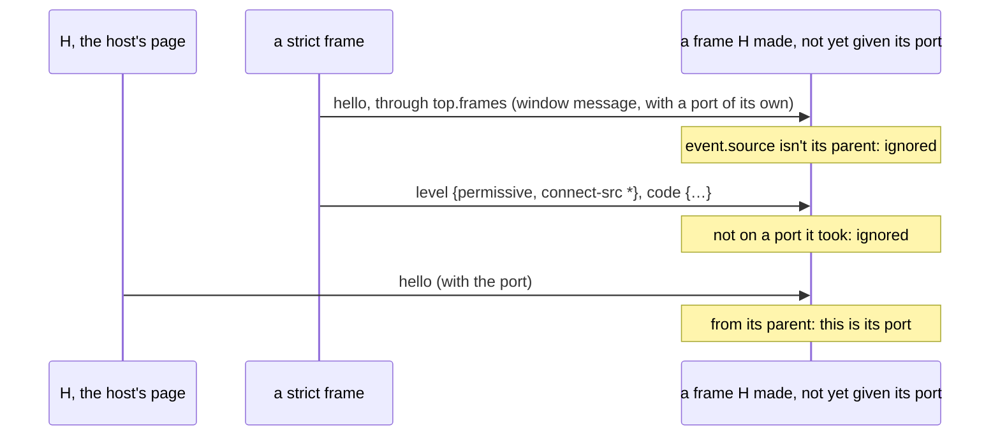

# The sandbox's frame protocol

**Status: accepted (2026-10-30; revised the same day from a star, where every frame believed the host's page, to a tree).** The messages between the windows of [the sandbox](sandbox.md): who sends what to whom, and what each end checks. It builds on `@compmd/render`'s frame protocol ([render README, "In a frame"](../render/README.md#in-a-frame)) and replaces the playground's own messages (`editor/src/protocol.ts`).

## Proposed decisions

1. **The protocol is a tree.** Each frame has one port, to its parent, the window that made it, and talks to nothing else. Everything it gets (its level, policy, code, part, `host`, pings) comes from its parent; everything it sends (`set`, links, errors, its size) goes to it. A parent passes on what concerns the windows above it.
2. **A frame believes its parent only,** by its window (`event.source === window.parent`), never by its origin: the host's page may have an opaque origin itself. Parents are never less trusted than their children ([sandbox, decision 1](sandbox.md#proposed-decisions)), and the frame documents' policies make sure of it, so a message from a parent is one the frame may act on.
3. **The protocol is a layer of its own, with no DOM.** The message types, with their version, and each end's rules as plain state machines over `@compmd/render`'s `Port`: a frame takes `code` only after `level`; a parent gives `host` only to children it was told to; `set` is checked against the use's node. It is tested in Node, apart from the browser, and its messages are published as a JSON Schema (`sandbox/protocol.schema.json`), so a frame runtime or host runtime written elsewhere, a host's own or a sandbox outside a browser, can check itself against it.
4. **Two runtimes implement it,** the frame runtime (one end in each frame) and the host runtime (the other end, in the host's page and in every frame that has children). The browser's part, making frames, adding the policy, the ping timer, is theirs, not the protocol's.
5. **`@compmd/render`'s protocol stays as it is,** for a page's tree: `render`, `splices`, `theme`, `ready`, `set`, `error`, `rendered`. The sandbox's messages travel on the same port, with their own version, as the playground's do today.

## The windows

| Window | Made by | Runs | May make |
|---|---|---|---|
| **H**, the host's page | the application; may itself be a sandboxed frame | the host runtime; the renderer and trusted components in host mode | P, U at any level, C |
| **P**, the page frame (frame mode) | H, one per document | the frame runtime, the renderer, the document's strict components | nothing |
| **U**, a use frame, `strict.html` or `permissive.html` | H; a permissive U, for a strict use in its slots | the frame runtime, the renderer for one use and its slots, components of its level | a permissive U: strict U |
| **C**, the compile frame | H, one per document | the compilers, no components | nothing |

In our [example](sandbox.md#the-examples), in frame mode: H makes P and C. In host mode: H renders the page, makes C, and makes U frames for `bar-chart` (with `sparkline` inside it), `mermaid`, `map` and `rating-summary`; a strict `legend` in `map`'s slot would be a U that `map`'s frame makes.

## The port

When a frame loads, its parent posts `hello` to its window with one end of a new `MessageChannel`. The frame takes the first window message whose `source` is its parent, and listens on that port only; it ignores every other window message. The parent knows the frame by the window it made (`iframe.contentWindow`).

## Messages

**A parent to its frame:**

| Message | Says | To |
|---|---|---|
| `hello {version}` (a window message, with the port) | this is your port | every frame |
| `level {level, policy?}` | your level; for `permissive.html`, the second policy, with the pack's origins, which the frame adds before anything else | every frame, first |
| `code {components}` | each component's code: compiled text with its binding (`react`, `svelte`, `plain`) and CSS, or a module's `{url, integrity}`; for a permissive frame, its strict children's code too, which it passes on | P, U |
| `render`, `splices` | `@compmd/render`'s | P |
| `part {node, inputs}` | the use to render, with its slots as expanded nodes, and the document's inputs | U |
| `theme {tokens}` | `@compmd/render`'s | P, U |
| `styles {urls}` | the host's stylesheets | P, U |
| `host {port}` | a port for `host`, as calls and events | U frames of permissive packs given `host`, from H only |
| `ping {n}` | answer, or be stopped | every frame |
| `compile {name, language, runtime, code}` | compile this | C |

**A frame to its parent:**

| Message | Says | From |
|---|---|---|
| `ready {sandbox}` | the frame listens, with the sandbox protocol's version; a page frame's renderer then sends `@compmd/render`'s own `ready` too | every frame |
| `loaded` | the code last sent is loaded, or shows fallbacks | P, U |
| `set {input, value}` | a component set an input, in `@compmd/render`'s shape; the parent checks that one of the frame's uses binds a param to that input, and passes it up | P, U |
| `error {reason, component, message}` | `@compmd/render`'s, plus `failed` (code that didn't compile or load) and `not-here` (a use whose level this frame can't hold, Q2 of the design) | P, U |
| `link {url}` | a link was clicked; H decides what opens, and shows the reader the URL first (spec §15 rule 4) | P, U |
| `rendered {ms}` | `@compmd/render`'s | P, U |
| `size {width, height}` | the content's size, for the parent to set on the frame | U |
| `pong {n}` | the answer to `ping` | every frame |
| `compiled {name, code, css?}`, `failed {name, message}` | a compile's result | C |

A parent passes its children's `set`, `link` and `error` up, each with what it knows of where they came from, so H gets them all.

## Sequences

**Opening a document, frame mode.** H makes C and P, each a `strict.html`. Each sends `ready`; H sends `level {strict}`, then C each component's source, and P `code` and `render`. P renders the page and mounts `bar-chart`, `sparkline` and `mermaid`; `stars`, `rating-summary` and `map` show their fallbacks, and P sends `error {not-here}` for each.

**Opening a document, host mode.** H renders the page; `stars` mounts in it. For `bar-chart` it makes a `strict.html` frame in the chart's box and sends `hello`, `level {strict}`, `code` (the bar chart's and the sparkline's) and `part` (the chart's node, the sparkline in its slot). For `map` it makes a `permissive.html` frame and sends `level {permissive, policy}` with `tiles.example.com`, then `code` and `part`; for `rating-summary` the same, plus `host`.

**A strict use inside a permissive one.** `map`'s frame renders its slot, finds `legend`, makes a `strict.html` frame there, and sends it `hello`, `level {strict}`, `code` (from what H sent it) and `part`. It pings it, and passes its `set`, `link` and `error` up to H.

**An edit.** H sends P `splices` (frame mode) or renders them (host mode), and sends `part` to every frame whose use changed; a frame does the same for its children. Uses keep their frames through edits, as the renderer's keys keep its views, so an edit updates a frame instead of making it again. A use that is gone loses its frame; a new one gets one. When the document's components change, H compiles them in C and sends `code` to the frames that have them, which pass on their children's.

**A frame that hangs.** Each parent pings its frames every second; a frame that hasn't answered within `timeout` is removed, and its use shows its fallback (W118).

**Strict code tries to break out.**

| It tries | What happens |
|---|---|
| to make a frame of `permissive.html` or `strict.html` | refused: `strict.html` has `frame-src 'none'` |
| a `srcdoc` frame | it inherits the strict policy: no network, whatever it is sent |
| to send a frame a second policy, code or params | the frame takes them only on its port, from its parent |
| to post `set` for an input its use isn't bound to | its parent checks `set` against the use's node, and drops it |
| to get `host` | only H gives `host`, and only to a `permissive.html` frame of a pack given `host` |

## The sequences, drawn

**Opening a document in frame mode.** The page and its strict components share one frame; the compile frame runs no components.

```mermaid
sequenceDiagram
    participant H as H, the host's page
    participant C as C, the compile frame
    participant P as P, the page frame
    H->>C: hello (window message, with the port)
    C-->>H: ready {sandbox}
    H->>C: level {strict}
    H->>C: compile {chart, jsx, …}
    C-->>H: compiled {chart, code}
    H->>P: hello (window message, with the port)
    P-->>H: ready {sandbox}
    H->>P: level {strict}
    H->>P: code {chart: strict, map: permissive, stars: trusted}
    P-->>H: loaded
    H->>P: render {tree}
    Note over P: mounts chart; map and stars show their fallbacks
    P-->>H: error {map, not-here}, error {stars, not-here}
    P-->>H: rendered {ms}
    P-->>H: set {region, eu}
    Note over H: checks that a use binds region, then processes again
```

**Host mode, with a strict component in a permissive one's slot.** Each frame believes its parent only; the permissive frame makes the strict one and passes on what H gave it.

```mermaid
sequenceDiagram
    participant H as H, the host's page
    participant M as map's frame (permissive)
    participant L as legend's frame (strict)
    Note over H: renders the page; stars mounts inline
    H->>M: hello (with the port)
    M-->>H: ready {sandbox}
    H->>M: level {permissive, connect-src tiles.example.com …}
    Note over M: adds its second policy before any code
    H->>M: host (a port, if the pack is given host)
    H->>M: code {map: permissive, legend: strict}
    H->>M: part {map's node, legend in its slot}
    M->>L: hello (with the port)
    L-->>M: ready {sandbox}
    M->>L: level {strict}
    M->>L: code {legend}, part {legend's node}
    L-->>M: set {layer, roads}
    Note over M: checks that its part binds layer
    M-->>H: set {layer, roads}
```

**Strict code poses as a parent.** A frame takes its hello from the window that made it, and nothing else.



**A frame that hangs.**

```mermaid
sequenceDiagram
    participant H as the frame's parent
    participant U as a use's frame
    loop every second
        H->>U: ping {n}
        U-->>H: pong {n}
    end
    Note over U: a component loops forever
    H->>U: ping {n+1}
    H->>U: ping {n+2}
    Note over H: no answer within the timeout
    H->>H: removes the frame; the use shows its fallback (W118)
```

## Checks, by end

- **A frame:** its port comes in a window message from its parent; it adds the `level` policy before it loads any code; it runs code and renders parts only from its port; it answers `ping`.
- **A parent:** it makes children only of a lower level than its own (a permissive frame, only strict ones); it sends each child only its own use's part and code; it checks each `set` against the use's node; it pings its children.
- **H:** it gives `host` only to permissive frames of packs the configuration gives `host`; it never acts on `link` without the reader.

## Versions

The sandbox's version travels in `hello` and `ready`, beside `@compmd/render`'s. A host may serve the frame documents from an older deploy than its page: a frame with another version gets nothing, and its parent reports it.

## From the playground's messages

| Playground (`editor/src/protocol.ts`) | Sandbox |
|---|---|
| `FRAME_HELLO` with the port | `hello {version}` |
| `components {components}`, compiled in the frame | `code {components}`, compiled in C |
| `components-loaded` | `loaded` |
| `component-failed` | `error {reason: "failed"}` |
| `host-style {style}` | `styles {urls}`; the playground's stylesheet picker becomes a list of URLs |
| `source-link {fragment}`, `open-link {url}` | `link {url}`; the playground handles `#:~:text=` links itself |

## Open

- **`@compmd/render`'s protocol** could take the sandbox's messages into its own, or stay as it is with the sandbox's beside it on the same port (recommended, decision 5): a host that builds its own sandbox can still use `connectFrame` and `serveFrame` alone.
