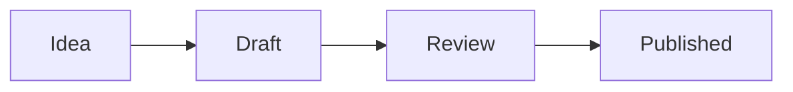

# Mermaid, from npm

This document imports a pack the playground doesn't have: [`@comp-markdown/mermaid`](#:~:text=@comp-markdown/mermaid@0), published on npm. The playground fetches it from the registry the first time a document asks for it, checks it against the hash npm publishes, and keeps it for later visits. Until it arrives, each diagram shows its code; then the page draws them. The pack bundles all of Mermaid, so the first visit downloads about 1.6 MB.



A sequence diagram:

```mermaid {alt="The reader asks the playground for the pack; the playground asks npm, checks it, and draws"}
sequenceDiagram
  Reader->>Playground: Open the document
  Playground->>npm: The pack @comp-markdown/mermaid@0
  npm-->>Playground: Its tarball
  Playground-->>Reader: The diagrams, drawn
```

## From data

A code block is never interpolated, so a diagram made from data is the same component written as a leaf, its code a param. This one is made from the `steps` key of the frontmatter:

:: mermaid[The steps: Idea, Draft, Review and Published] {code=("graph TD; " + md.doc.steps.join(" --> "))}

## Where it doesn't run

The pack's code runs in the strict sandbox, with no network: it can draw, and nothing else. A reader whose renderer doesn't know the pack, a plain Markdown viewer, sees the code blocks as they are, and the leaf's text in brackets. GitHub draws the blocks itself, with its own Mermaid.

## What npm learns

The playground has no server, so the reader's browser fetches the pack from npm itself. npm then learns the reader's address and which packs, at which versions, the document imports: never the document, or anything it shows.

> [!TIP]
> **Try it.** Add `Archived` to [`steps: [Idea, Draft, Review, Published]`](#:~:text=steps:%20%5BIdea), and the last diagram grows a step. Switch the page to dark: the diagrams follow it. Then write a version npm doesn't have, [`@comp-markdown/mermaid@9`](#:~:text=@comp-markdown/mermaid@0): the pack can't be had, so each block shows its code, and the leaf its text, with a diagnostic.
