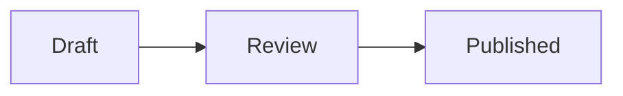

---
md:
  import:
    - from: "@preview/minimermaid@0"
      names: [minimermaid]
---

# minimermaid

The same component as a leaf, its code a param:

:: minimermaid[Found, then reading, then read] {code="graph TD; Found --> Reading --> Read" theme=neutral}
