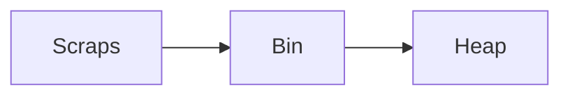

# 17. Code blocks a pack draws

Some packs draw code blocks: a document that imports `@comp-markdown/mermaid` gets every ` ```mermaid ` block drawn as a diagram, while the text stays an ordinary code block that any Markdown viewer can show. This chapter gives the newsletter a diagram of the compost, written as a code block, and shows when to write a block and when a leaf.

## The newsletter, with a code block

````md snippet=code-blocks/garden.comp.md
---
md:
  version: 1
  import:
    - from: "@comp-markdown/mermaid@0"
      names: [mermaid]
title: Elm Street Garden
issue: November 2026
rotation: [Beans, Cabbages, Roots, Potatoes]
---

# {{md.doc.title}}

News from the plots, {{md.doc.issue}}.

## Where your scraps go

The green bin by the gate takes your kitchen scraps all winter. This is their way back to the beds:

```mermaid {theme=forest alt="Kitchen scraps go in the green bin, then on the compost heap; turned on work days, the compost goes on the beds in spring"}
graph LR
  Scraps[Kitchen scraps] --> Bin[Green bin by the gate]
  Bin --> Heap[Compost heap]
  Heap -->|turned on work days| Compost
  Compost -->|in spring| Beds[The beds]
```

No meat, no bread, nothing cooked: they bring rats.

## Next year's beds

:: mermaid[Beans, then cabbages, then roots, then potatoes, then beans again] {code=("graph LR; " + md.doc.rotation.join(" --> ") + " --> " + md.doc.rotation[0])}
````

[Try it](https://compmd.dev/playground/?doc=guides/authors/code-blocks) in the playground. Change `theme=forest` to `theme=dark`, or add a step to the compost's way, and the diagram follows.

## A code block, drawn

The compost's diagram is written in [Mermaid](https://mermaid.js.org/), a language for diagrams that exists outside CompMD. You write it as you would in any Markdown file: three backticks, the language, the diagram's text, three backticks.

What makes it a drawing is the import. The `mermaid` component the newsletter imports for its leaf in chapter 16 also says, in its pack, that it draws the code blocks of the languages `mermaid` and `mmd`. Such a component is a *code renderer*. Once it is imported, every block of those languages in the document is drawn by it; nothing else in the document changes. Without the import, a ` ```mermaid ` block is a code block like any other, and no diagnostic says so, since most code blocks are just code.

A code block shows its text as you wrote it. `{{md.doc.title}}` inside it stays `{{md.doc.title}}`, as in any code block (chapter 4): a block's diagram is the same for every reader.

## Params on the block

Params go on the block's first line, in braces after the language, written as a component's are (chapter 3):

| Param | Takes |
| --- | --- |
| `theme` | the Mermaid pack's own param: `auto`, the default, follows the page, Mermaid's dark theme on a dark page; `default`, `dark`, `neutral` and `forest` are Mermaid's themes |
| `alt` | the drawing's text alternative, below; every drawn block takes it |
| `render` | what shows: `output`, the drawing (the default); `source`, the code alone; `both`, the code, then the drawing; every drawn block takes it, below |
| `width`, `padding`, `border`, … | the common params of chapter 3, for the box the drawing is in: `width=50%` |
| `.name`, `#name` | a class and an id, as on any component |

The block's text is the component's `code` param, so `code` can't also be given in the braces: `code=…` there is `F017`, and ignored. A value the param doesn't take is `F009`, which says what it does take: write `theme=frest`, and the playground offers `forest`.

CompMD reads the braces only when a code renderer draws the block. On a block nothing draws, such as a ` ```sh ` block, the line stays as you wrote it, so what other tools put there is left alone.

## `alt`, the text alternative

A drawing can't be read aloud. `alt` is what a screen reader says in its place, as a leaf's fallback is (chapter 3): write in it what the diagram shows, in a sentence. A drawn block without `alt` is `W101`, at its first line.

The diagram's text is no help here: `Bin --> Heap` means something to Mermaid, not to a listener. Write `alt` as you would tell someone what the picture shows.

## The code beside the drawing

A page that explains a diagram wants its code shown too. `render=both` shows the block's code, then the drawing, in one box, so the code is written once:

````md

````

`render=source` shows the code alone, as if nothing drew it: the drawing isn't made, and the block needs no `alt`. The block's other params are still checked, so changing it back to `render=output`, or leaving `render` out, brings no surprises. `render` is written bare, as these three words: `render="both"` and `render=(…)` are `F009`, since what a block shows is chosen as you write it.

Wherever the drawing can't be made, a `both` block shows its code once, not twice. A plain Markdown viewer shows the code block, whatever `render` says.

On screen, CompMD's renderer keeps a `both` block's code folded under a bar that names it, its language and its lines, with **Show code** and **Copy**: the drawing comes first to the eye, and the code is a click away. On paper, the code prints above the drawing.

## CompMD beside what it makes

A post about CompMD itself does the same with a ` ```compmd ` block: `render=both` shows the CompMD, then what it makes.

````md
```compmd {render=both}
---
rating: 4
---
Rated :value[4 of 5]{of=(string(md.doc.rating) + " of 5")}.
```
````

Such a block is an *example*: a little document of its own. Its frontmatter, imports, inputs and components are its own, and nothing of the post reaches into it, so `md.doc.rating` here is the example's 4, whatever the post's frontmatter says. Its mistakes show where they are written, in the block. A ` ```compmd ` block is code unless it says `render=output` or `render=both`, so the CompMD you show as code stays code; and an example inside an example shows its code only (`W123`).

## A block or a leaf

The rotation's diagram, from chapter 16, is the same `mermaid` component as a leaf. Which to write depends on where the diagram's text comes from:

| The diagram's text is | Write | Because |
| --- | --- | --- |
| written out, the same for every reader | a code block | a reader of the plain file sees the diagram's source, and GitHub draws it |
| made from the frontmatter, data or inputs | a leaf, with the text as its `code` param | a code block is never filled in from values; an expression can be |

The compost's way doesn't change, so it is a block. The rotation's beds come from the frontmatter, and its diagram grows a step when the list does, so it is a leaf. One import gives both: the component can't tell them apart, and draws them the same way. The leaf's fallback in brackets is its text alternative, as `alt` is the block's.

## What other readers see

| Shown by | The block | The leaf |
| --- | --- | --- |
| an app with the pack | the diagram | the diagram |
| the same app while the pack arrives (chapter 16) | the code block, then the diagram | the fallback, then the diagram |
| an app that can't get the pack | the code block | the fallback |
| a plain Markdown viewer | the code block | the line, with its fallback in it |
| GitHub | a diagram GitHub draws itself from ` ```mermaid ` | the line, with its fallback in it |

A block's fallback is the code block itself: where it can't be drawn, it shows its text, as any Markdown viewer shows a code block. GitHub knows Mermaid but not CompMD, so it draws ` ```mermaid ` blocks in its own way, without the params.

## When it isn't drawn

- **The pack can't be had.** The import is `F026`, which says why (chapter 16). The document still shows: the blocks stay code blocks, and the leaves show their fallbacks.
- **Mermaid can't read the diagram,** say a line ends in `-->` with nothing after it. The block shows its code, and the app reports what Mermaid found as `W118`; the playground shows it on the block. When the text is fixed, the diagram draws again.
- **Two packs draw the same language.** If two components you import both draw ` ```mermaid `, a ` ```mermaid ` block is `F023`, which names both. Import only one of them by name, or list it explicitly while the other comes with `names: "*"`.

Giving a code renderer another name with `as` (chapter 16) renames the leaf only: `:: diagram[…] {…}`. Blocks are chosen by their language, so ` ```mermaid ` blocks are still drawn.

A code renderer can also be written in CompMD itself, as a definition whose signature says which language it renders; the [spec's section on code renderers](https://compmd.dev/spec/#77-code-renderers) has the details.

## Wireframes

Another pack, `@comp-markdown/wireframe`, draws sketches of screens: the newsletter shows the plot booking the garden is building before anyone writes a line of it.

````md snippet=wireframes/booking.comp.md
---
md:
  version: 1
  import:
    - from: "@comp-markdown/wireframe@0"
      names: [wireframe]
title: Elm Street Garden
---

# Booking a plot online

From March you can book a plot from your phone. This is the first sketch of the screen: tell us at the next work day what is missing.

```wireframe {alt="The booking screen on a phone: a half or a full plot, the month you start, a key to the tool shed, and a Book button"}
window "Book a plot" device=phone:
  header:
    text "Elm Street Garden" bold
  section "Your plot":
    radio "Half plot" group="size" selected
    radio "Full plot" group="size"
    combo "Starting" value="March" options="March, April, May"
  checkbox "A key to the tool shed" label-right
  button "Book" primary id=book
annotation "You get an email to confirm" target="book" position=bottom
```

The paper list by the gate stays until everyone who wants a plot has one.
````

A ` ```wireframe ` block is a screen written as an outline, one part per line:

- **`window`** is the screen, its title in quotes; `device=phone`, `tablet` or `browser` draws it as one, a desktop window without.
- **A line ending in `:`** holds the lines indented under it, by two or four spaces: `header`, `footer`, `panel`, `section "Title"`, `row` and `col` lay the parts out, `grid` places `cell`s by row and column.
- **Controls** are drawn as what they stand for: `button "Book" primary`, `input placeholder="Email"`, `combo`, `checkbox`, `radio`, `toggle`, `tabs`, `list`, `tree`, `menubar`, `progress`, `image`, `icon` and `text`. A control's flags come after its text: `selected`, `checked`, `on`, `disabled`.
- **`annotation`**, after the window, puts a numbered note beside it, pointing at the part with that `id`.

The whole language, with every part and what it takes, is the pack's [`LANGUAGE.md`](https://github.com/comp-markdown/compmd/blob/main/compmd-packs/wireframe/LANGUAGE.md). It is Wireloom's syntax, with a few additions that page marks, such as `device`: a sketch written for Wireloom reads here as it is.

The sketch is drawn in greys, light or dark as the page is, and its words are text a reader can select. `alt` says what the screen shows, as for a diagram. A line the pack can't read shows the block's code, and the app reports `W118` with where the mistake is, `line 4, column 5: no part \`butn\`: did you mean \`button\`?`. With `render=both`, the block shows its outline above the sketch, for a post that explains how it is written.

Next: [components in code, in brief](18-components-in-code-in-brief.md), for what a component written in JSX, Svelte or JavaScript looks like to the document that uses it.
