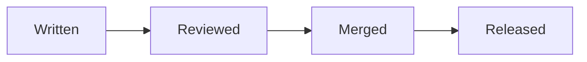

# 9. Packs from npm

Your documents can use packs published on npm, in two ways: you install a pack with your app, or your app fetches the packs a document imports from a registry while it runs. Either way, your configuration says what each pack may do, and a document can never ask for more. This chapter builds a page that draws a diagram with a pack it never installed.

## Installing a pack

```sh
npm install @comp-markdown/mermaid
```

That's all. `@compmd/vite` finds every installed scoped package that is a CompMD pack (its `package.json` names its document in a `compmd` field, or it has an `index.comp.md`) and gives it to the processor in `virtual:compmd`'s `request.packs`, with its integrity from your lock file, for documents that pin it. It serves the pack's built modules from your app, under `compmd/packs/`, and tells the sandbox where each one is, with its file's hash. A document that imports `@comp-markdown/mermaid@0` now gets it.

Every installed pack is available to every document, in the strict sandbox, with nothing to configure. The configuration is for what goes beyond that.

## The configuration

`compmd.config.json`, next to your app's `package.json`, is your app's policy for packs: never a document's, and never a pack's. Its keys:

```json
{
  "$schema": "./node_modules/@compmd/vite/compmd.config.schema.json",
  "packs": {
    "@kit/charts": { "version": "^2.0.0" },
    "@acme/maps": { "trust": "permissive", "network": ["https://tiles.example.com"] },
    "@acme/reviews": { "trust": "permissive", "host": true },
    "./components": { "trust": "trusted", "ambient": true }
  },
  "imports": "any",
  "deny": [{ "pack": "@bad/pack", "version": "<2", "reason": "a flaw found in 1.x" }],
  "maxPackSize": "10 MB",
  "libraries": ["d3"],
  "registries": { "*": "https://registry.npmjs.org/" },
  "fetch": "host"
}
```

| Key | What it is |
| --- | --- |
| `packs` | the packs that get more than the defaults, by name, or by folder for a pack in your app ([chapter 10](README.md#contents)) |
| `packs.*.trust` | `strict` (the default); `permissive`, a frame of its own with the network to the origins you list, and `host` if you give it; `trusted`, in your page, for a folder of your app only ([chapter 8](README.md#contents)) |
| `packs.*.network` | the origins a permissive pack may reach, each `https://host[:port]` |
| `packs.*.host` | whether a permissive pack's components get `host`, the calls your app offers them |
| `packs.*.ambient` | every document gets the pack's names without importing it |
| `packs.*.version` | a range the installed version must satisfy, checked when your app builds |
| `imports` | `any` (the default): a document may import any pack; `listed`: only those in `packs` |
| `deny` | packs your app won't serve, all versions or a range, with the reason readers see |
| `maxPackSize` | the largest pack a document gets, in bytes or as `"10 MB"`; for a pack from a registry, checked before it is downloaded (10 MB when not given) |
| `libraries` | npm packages you install that the frames offer components by name, besides React and Svelte |
| `registries` | where packs your app doesn't install come from, by scope (`"@kit"`), with `"*"` for every other scope |
| `fetch` | who reaches the registries: `host` (the default), through your app's proxy; `direct`, the reader's browser |

`deny` is your own policy, for content you won't show or packs you won't serve; it isn't what keeps readers safe. The sandbox does that for every pack, denied or not, known or not.

The plugin checks the configuration when your app builds, and in development when it changes: every problem at once, each listed pack installed at the version it asks for, and each listed pack's documents through the processor.

## Packs your app doesn't install

With `registries`, a document may import any pack published on npm, and your app fetches it the first time a document asks. Three files more than the [quick start](02-quick-start.md)'s, with the same `vite.config.ts`. The configuration names npm, reached through your app's proxy, and keeps the default size cap:

```json snippet=packs-from-npm/compmd.config.json
{
  "registries": { "*": "https://registry.npmjs.org/" },
  "fetch": "host",
  "maxPackSize": "10 MB"
}
```

A document that imports the Mermaid pack, which the app doesn't install, and uses it to draw a code block:

````md snippet=packs-from-npm/plan.comp.md
---
md:
  import:
    - from: "@comp-markdown/mermaid@0"
      names: [mermaid]
---

# How a change ships

Every change goes the same way, and nobody merges their own:


````

[Try it](https://compmd.hakanserce.com/playground/?doc=guides/developers/packs-from-npm) in the playground, which fetches its packs from npm the same way.

The page, as in the quick start:

```html snippet=packs-from-npm/index.html
<!doctype html>
<html lang="en">
  <head>
    <meta charset="utf-8" />
    <title>A pack from npm</title>
  </head>
  <body>
    <main id="page" style="height: 24rem"></main>
    <script type="module" src="./main.ts"></script>
  </body>
</html>
```

And `main.ts`, which resolves the document's packs before it opens the document:

```ts snippet=packs-from-npm/main.ts
import { init, OpenDocument } from "@compmd/processor";
import { defaultCache, resolvePacks } from "@compmd/registry";
import { createSandbox } from "@compmd/sandbox";
import { registry, request, sandbox } from "virtual:compmd";
import text from "./plan.comp.md?raw";

await init();

// The document with what the app gives it, then the packs it imports that the app doesn't install, from the registry.
const asked = { ...request, path: "plan.comp.md", files: { "plan.comp.md": text }, now: new Date().toISOString() };
const resolved = registry && (await resolvePacks(asked, { ...registry, cache: defaultCache() }));
for (const { pack, message } of resolved?.problems ?? []) console.warn(`${pack}: ${message}`);
const opened = new OpenDocument(resolved?.request ?? asked);

// A fetched pack's built module reaches its frame as code, already checked; an installed one's by its URL.
const page = document.getElementById("page") as HTMLElement;
const modules = (place: Parameters<typeof sandbox.modules>[0]) => resolved?.modules(place) ?? sandbox.modules(place);
const view = createSandbox({ ...sandbox, modules }).open(page, { components: opened.components });
view.render(opened.expanded);
```

Install `@compmd/registry` beside the packages of the quick start, and run it: the page shows the heading, then the diagram, drawn by a pack the app has never seen before.

## What just happened

- `virtual:compmd`'s `registry` is what `resolvePacks` takes from your configuration: the registries, who fetches, and the size cap. Without `registries`, it is `undefined`, and the document opens with what your app installs.
- `resolvePacks` asked the processor which packs the document imports that the request doesn't hold (`sources`), resolved each range to the newest matching version, and applied your policy before downloading anything: `deny`, `imports`, and the size cap, from the registry's metadata. Then it fetched the pack's tarball, checked it against the hash npm publishes (and the document's `integrity`, when it pins one), and asked again for the packs that pack imports, until none was missing.
- It gave back the request with the packs added, and `modules`: each fetched pack's built modules, as checked files. The sandbox sends a frame such a module as it sends compiled source, and the strict frame still loads nothing from the network.
- What couldn't be had is in `problems`, and the document says it too: an import no registry could give is `F026`, its uses showing their fallbacks.
- `defaultCache()` keeps what was fetched in the browser's Cache Storage, by integrity: a version never changes, so a later visit fetches nothing but the versions list, once it is older than npm says it may be.

## Who fetches, and what the registry learns

With `"fetch": "host"`, the page reaches the registries only through your app's proxy, at `compmd/registry/`, which passes each request on to its scope's registry: npm learns nothing about your readers. The dev server and `vite preview` serve the proxy. A deployed app serves it from its server or a worker, with the same registries; `registryProxy` is a fetch handler, here a worker's:

```ts
import { NpmRegistry, registryProxy } from "@compmd/registry";

export default { fetch: registryProxy({ registries: { "*": new NpmRegistry({ url: "https://registry.npmjs.org/" }) }, base: "/compmd/registry/" }) };
```

It caches nothing itself, so put an HTTP cache or a CDN in front of it; [its README](../../registry/README.md) has the same for Node. A private registry's token stays on your server, in its `NpmRegistry`'s `headers`, never in the reader's browser.

An app with no server, such as a static site, can't proxy. With `"fetch": "direct"`, the reader's browser fetches from the registries you name, with no cookies or other credentials, and nothing from the document but the names and versions of its imports. The registry then learns the reader's address and which packs, at which versions, the document imports; never the document. Tell your readers, as the playground does in its About.

Neither a document nor a pack can name a registry: imports name packs, and your configuration says where packs come from. A pack's own imports go through the same registries and policy as the document's.

## Rendering before the packs arrive

The example waits for its packs before showing anything. An editor can't: it processes on every keystroke. Open the document at once with what you have, resolve its packs in the background, and open it again when they arrive. Until then, the uses of a pack the request doesn't hold show their fallbacks (`F026`), and the rest of the page is there. The playground works this way, asking for missing packs once typing pauses, so a name typed letter by letter isn't fetched letter by letter.

## What a pack from a registry can do

The same as an installed one: a pack nobody listed runs strict, whoever published it, wherever it came from. Only your configuration gives a pack more, by name, and it applies to the pack wherever your app gets it. So a document from anyone can import any pack, and still can't reach your page, your session, or your readers' data.

Next: your app's own components *(to come)*.
