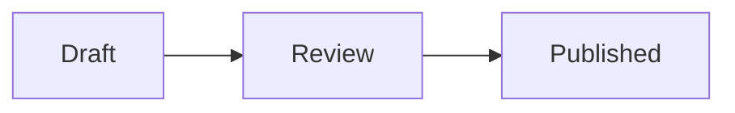

# 16. Code renderers

Some content is source in a language of its own: a diagram in Mermaid, a table as CSV, music as ABC. A document writes it as a fenced code block, which every Markdown renderer shows as code. A **code renderer** is a leaf whose signature also names a language, so it draws that language's blocks in every document that imports it, and is still a leaf for source made from data (spec [§7.7](https://compmd.hakanserce.com/spec/#77-code-renderers)). This chapter writes one that draws ` ```csv ` blocks as tables, then looks at the Mermaid pack.

## Writing one

```sh
npm create @compmd/pack csv -- --name @you/csv --renders csv
```

`--renders <language>` writes the same pack as a leaf's, with three differences: the signature says `renders: csv` instead of declaring `value`, the component reads `params.code`, and `demo.comp.md` writes a ` ```csv ` block and the same component as a leaf. The language is a code block's language name: lowercase letters, digits, `+` and `-`, starting with a letter.

## The signature

````md snippet=csv-pack/index.comp.md
---
md:
  import:
    - from: ./dist/csv.js
      names: [csv]
  export:
    pack: "@you/csv"
    version: "0.1.0"
    names: [csv]
---

# @you/csv

`csv` draws every ` ```csv ` block of a document that imports it as a table; a reader without it sees the values. Written as a leaf, its `code` is a param, for rows made from data: `:: csv[The totals] {code=("total,12\nopen,3")}`.

```compmd component=csv signature
renders: csv
params:
  header: boolean = true
```
````

- **`renders`** is a language, or a list of names of one language: the Mermaid pack's is `[mermaid, mmd]`.
- **`code`** is a param every code renderer has without declaring it: a required `string`, the block's text. A signature may declare it to document it, but only as a required `string` with no default; anything else is F009 on the declaration.
- **Other params** are declared as for any component, and a block gives them on its info string.
- **No slots**: a code renderer is a leaf.

The rest of the pack is the template's:

```json snippet=csv-pack/package.json
{
  "name": "@you/csv",
  "version": "0.1.0",
  "description": "A CompMD pack: draws ```csv blocks as tables.",
  "keywords": ["compmd", "compmd-pack"],
  "license": "MIT",
  "type": "module",
  "compmd": "./index.comp.md",
  "files": ["dist", "index.comp.md", "README.md"],
  "scripts": {
    "build": "compmd-pack build",
    "dev": "compmd-pack dev",
    "test": "compmd-pack test",
    "lint": "tsc --noEmit",
    "prepublishOnly": "compmd-pack build && compmd-pack test"
  },
  "devDependencies": {
    "@compmd/pack": "0.3.0",
    "happy-dom": "21.0.3",
    "typescript": "6.0.3",
    "vitest": "5.0.5"
  }
}
```

```json snippet=csv-pack/tsconfig.json
{ "extends": "@compmd/pack/tsconfig.json", "include": ["src"] }
```

## The component

```ts snippet=csv-pack/src/csv.ts
// `csv`: draws a ```csv block, its text in `code`, as a table; the first row is its header unless `header=false`.
import { component } from "@compmd/pack/component";

/** The params, as the signature in `index.comp.md` declares them, and `code`, which every code renderer has. */
export interface Params {
  code: string;
  header: boolean;
}

/** The rows of `code`: fields split at commas, a field in double quotes holding commas and `""` for a quote. */
export function rowsOf(code: string): string[][] {
  return code
    .split("\n")
    .filter((line) => line.trim() !== "")
    .map((line) => [...line.matchAll(/(?:^|,)(?:"((?:[^"]|"")*)"|([^,]*))/g)].map(([, quoted, plain]) => quoted?.replaceAll('""', '"') ?? plain?.trim() ?? ""));
}

export default component<Params>((target, { params, fallback }) => {
  const table = document.createElement("table");
  // The block's `alt`, or a leaf's fallback: the table's caption.
  const caption = Object.assign(document.createElement("caption"), { textContent: fallback.text });
  target.append(table);
  const cells = (row: string[], tag: "th" | "td") => {
    const tr = document.createElement("tr");
    tr.append(...row.map((text) => Object.assign(document.createElement(tag), { textContent: text })));
    return tr;
  };
  const draw = ({ code, header }: Params) => {
    const [first = [], ...rest] = rowsOf(code);
    const head = header ? [cells(first, "th")] : [];
    const body = (header ? rest : [first, ...rest]).map((row) => cells(row, "td"));
    table.replaceChildren(caption, ...head, ...body);
  };
  draw(params);
  return {
    update: draw,
    destroy: () => {
      table.remove();
    },
  };
});
```

It is an ordinary component in the plain binding, and the host contract is the same as a leaf's: the component can't tell a block from a leaf, and isn't told the block's language. Its cells are text, set with `textContent`, since a block's text is the document's.

## In a document

A document imports the component, and writes the block as it would anywhere:

````text
---
md:
  import:
    - from: "@you/csv@0"
      names: [csv]
---

# Visits

```csv {alt="Visits by city: Kyoto 12, Osaka 7"}
city,visits
Kyoto,12
Osaka,7
```

:: csv[Open and done] {code=("open,3\ndone,9") header=false}
````

- **The block's text is `code`**, as written: a code block is never interpolated.
- **The info string's param list**, after the language, gives the other params: `{header=false}`. It is read only when a code renderer renders the block; otherwise the info string stays as written, for other tools.
- **`alt` is the text alternative**, which every rendered block takes, as every component takes `class` and `id`: it is the component's `fallback.text`. Write what the block shows.
- **The block is the fallback**: a reader without the pack, a plain renderer, or a host where the component fails sees the code block.
- **The leaf** is the same component, its source the `code` param, for source made from data or inputs: `code=(…)` computes it, as `:: csv` does here. Its fallback is its text in `[…]`, as for any leaf.
- **A box**: a rendered block has an outer box, as a leaf has, so the common params apply: ```` ```csv {alt="…" max-width=30rem} ````.
- **Blocks only.** A code span has no language, so a code renderer draws no inline code. A ` ```math ` block is always math, never a code renderer's.

**Which component draws a block** is found by its language, among the components the document can name, as a name is found: local definitions, then listed imports, then wildcard imports, then a host's ambient packs. A block whose language nothing renders stays a code block, with no diagnostic. Two code renderers of one language at the same level are F023 when a block of it is used; listing one of them by name resolves it. Renaming a code renderer on import (`{name: csv, as: table}`) renames the leaf only: ` ```csv ` blocks still render.

## What is checked

As for any leaf, and the block's own rules. A document with three mistakes:

````text
---
md:
  import:
    - from: "@you/csv@0"
      names: [csv]
---

```csv
city,visits
```

```csv {alt="Visits" code="a,b"}
city,visits
```

```csv {alt="Visits" header=maybe}
city,visits
```
````

gives W101 for the first block, which has no `alt`, F017 for the second, which gives `code` on its info string as well as its text, and F009 for the third, whose `header` isn't a boolean, so `header` is treated as absent and its default used.

## Its tests

`mountForTest` gives the component `code` as any param, and the block's `alt` as the fallback:

```ts snippet=csv-pack/src/csv.test.ts
import { mountForTest } from "@compmd/pack/testing";
import { describe, expect, it } from "vitest";
import mount, { rowsOf } from "./csv.ts";

describe("rowsOf", () => {
  it("splits fields at commas, but not inside quotes", () => {
    expect(rowsOf('city,visits\n"Kyoto, Japan",12\n')).toEqual([
      ["city", "visits"],
      ["Kyoto, Japan", "12"],
    ]);
  });
});

describe("csv", () => {
  it("draws the block's rows under its header, captioned with its alt, and follows new params", () => {
    const shown = mountForTest(mount, { params: { code: "city,visits\nKyoto,12", header: true }, fallback: "Visits by city" });
    expect(shown.target.querySelector("caption")?.textContent).toBe("Visits by city");
    expect([...shown.target.querySelectorAll("th")].map((cell) => cell.textContent)).toEqual(["city", "visits"]);
    shown.update({ code: "Kyoto,12\nOsaka,7", header: false });
    expect(shown.target.querySelectorAll("th")).toHaveLength(0);
    expect(shown.target.querySelectorAll("tr")).toHaveLength(2);
    shown.destroy();
    expect(shown.target.children).toHaveLength(0);
  });
});
```

## A real one: the Mermaid pack

[`@comp-markdown/mermaid`](../../packs/mermaid/README.md) draws Mermaid diagrams in any document that imports it, with no support from the host. Its signature, in [its document](../../packs/mermaid/index.comp.md):

```text
renders: [mermaid, mmd]
params:
  theme: auto | default | dark | neutral | forest = auto
```

Its component, [`src/mermaid.ts`](../../packs/mermaid/src/mermaid.ts), is written with `draw` ([chapter 15](15-react-svelte-and-libraries.md#drawing-asynchronously)):

- **Mermaid is bundled in**, pinned at 12.2.0, with everything it loads: one module of 7.0 MB minified, under the 10 MB a host takes.
- **One draw at a time** (`oneAtATime`), since Mermaid's configuration is global: each draw calls `mermaid.initialize` with its theme, then `mermaid.render`.
- **`theme: auto`** draws with Mermaid's dark theme when `scheme` is `dark` and its default theme otherwise, and again when the scheme changes; another theme a block gives (`{theme=forest}`) is used as given.
- **Mermaid's own markup is sanitized by it**, with `securityLevel: "strict"`, since `draw` sets the SVG it returns as markup.
- **A diagram Mermaid can't read** throws `Mermaid couldn't read this diagram:` and the first line of Mermaid's message: the host reports W118, which an editor shows on the block, and the reader sees the code until it is fixed.

A document draws a block and a diagram made from its data with one import:

````md
---
md:
  import:
    - from: "@comp-markdown/mermaid@0"
      names: [mermaid]
steps: [Draft, Review, Published]
---



:: mermaid[The steps: draft, review, published] {code=("graph TD; " + md.doc.steps.join(" --> "))}
````

Its unit tests stub Mermaid, which happy-dom can't lay out, and check the theme for each scheme and the failure; its browser tests in the repository draw real diagrams in Chrome and WebKit.

Next: [testing and publishing](17-testing-and-publishing.md), from a pack's tests to npm, and to an app that uses it.
