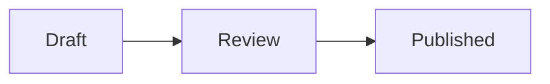

# @comp-markdown/mermaid

A [CompMD](https://compmd.hakanserce.com/) pack that draws [Mermaid](https://mermaid.js.org/) diagrams in any document that imports it, with no support from the host: ` ```mermaid ` blocks, and diagrams computed from the document's data. It bundles Mermaid 12.2.0 as one module, which runs in the host's strict sandbox. The design is [docs/mermaid-pack.md](../../docs/mermaid-pack.md).

## Use it in a document

````md
---
md:
  import:
    - from: "@comp-markdown/mermaid@0"
      names: [mermaid]
steps: [Draft, Review, Published]
---



:: mermaid[The steps: draft, review, published] {code=("graph TD; " + md.doc.steps.join(" --> "))}
````

- **A block** of ` ```mermaid ` or ` ```mmd ` is drawn; its `alt` is the drawing's text alternative. A reader without the pack, and GitHub, see the code (GitHub draws it too).
- **A leaf** takes the diagram's source as its `code` param, for a diagram made from data or inputs: a code block is never interpolated.
- **`theme`**: `auto` (the default) follows the page: Mermaid's dark theme on a dark page, its default theme on a light one. `default`, `dark`, `neutral` and `forest` are Mermaid's themes, as given: ```` ```mermaid {theme=forest} ````.
- **A diagram Mermaid can't read** shows its code, and a line saying what Mermaid found.

## Size

`dist/mermaid.js` is 7.0 MB minified, 1.6 MB gzipped (measured 2026-11-02): all of Mermaid's diagram types, with the ELK layout engine (2.5 MB of it before minifying), in one file, so a host can load it by URL or as text. A host fetches it once per version, and only for documents that import it. `@compmd/registry`'s default size cap is 10 MB.

## Licences

The pack is MIT. `dist/LICENSES.md` lists what its module bundles, each with its licence: Mermaid (MIT) and the libraries it uses.

## Try it

From the repository (`pnpm install` at its root first):

```sh
pnpm --dir packs/mermaid dev     # the test page, in host mode, in the strict sandbox
pnpm --dir packs/mermaid test    # the component in happy-dom, the test page in Chrome and WebKit, and the pack from a local registry
pnpm --dir packs/mermaid lint    # the type check
```

## Releases

The pack has its own version, for its component's params and forms; a new Mermaid is a new version of the pack. A tag `mermaid-v<version>` publishes it from CI (`RELEASING.md`).
