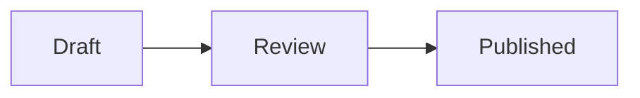
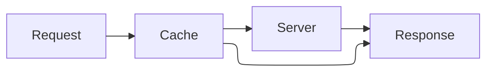
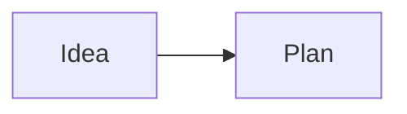

---
md:
  import:
    - from: "@comp-markdown/mermaid@0"
      names: [mermaid]
steps: [Draft, Review, Published]
---

# Mermaid diagrams

A flowchart:



A sequence diagram:

```mermaid {alt="The reader asks the host for a page, and the host answers"}
sequenceDiagram
  Reader->>Host: Open the page
  Host-->>Reader: The page
```

A diagram made from the document's data:

:: mermaid[The steps: draft, review, published] {code=("graph TD; " + md.doc.steps.join(" --> "))}

Laid out with ELK, which Mermaid 12 bundles:



In Mermaid's forest theme:



One Mermaid can't read:

```mermaid {alt="A diagram with a mistake"}
graph LR
  A -->
```
