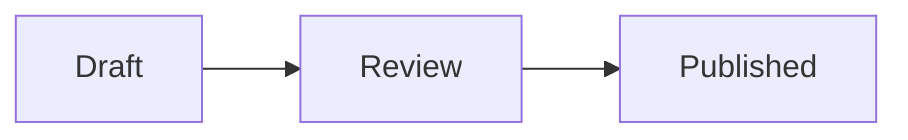

```compmd component=mermaid signature
renders: mermaid
```

```js component=mermaid
export default function mount(target, { params }) {
  const draw = ({ code }) => {
    const steps = code.replace("graph LR;", "").split("-->");
    target.textContent = steps.map((step) => step.trim()).join(" → ");
  };
  draw(params);
  return { update: draw };
}
```


